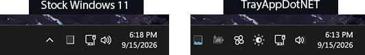
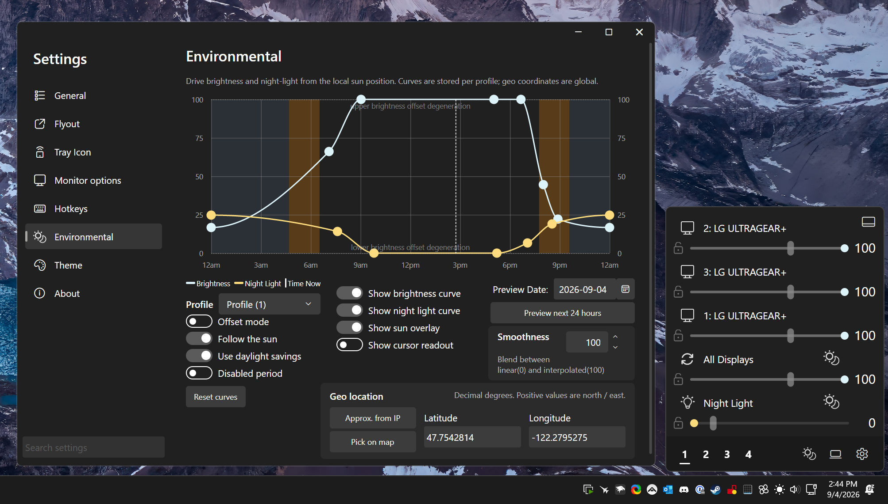
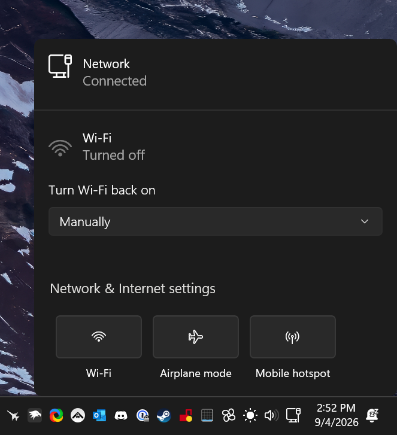
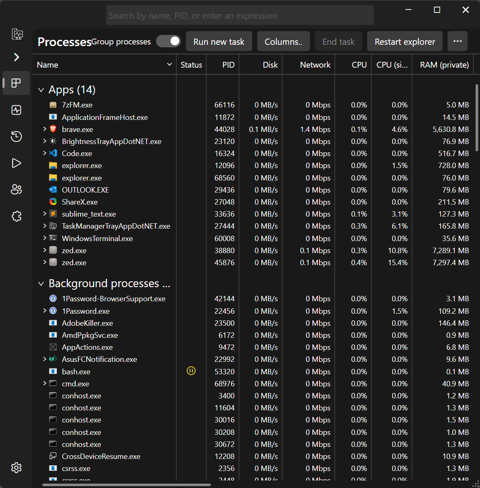
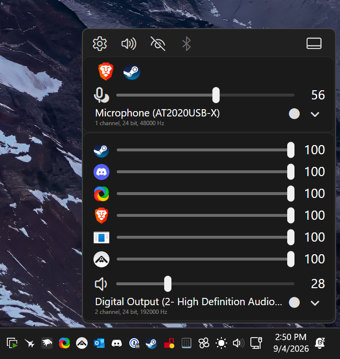

<h1 align="center">TrayAppDotNET&nbsp;</h1>

<em>A suite of Windows 11 apps focused around one of the most under-loved pieces of UX ever.</em>

  
  
  
  
  

## Overview

These are my projects for replacing, and adding to, the Windows 11 tray system apps. For the best effect, I recommend removing the stock Windows tray icons with <a href="https://windhawk.net/">Windhawk</a>.

<figure align="center">
  
  <figcaption><em>This is an incomplete example. Stock tray icons were removed with <a href="https://windhawk.net/mods/taskbar-tray-system-icon-tweaks">this Windhawk mod</a>.</em></figcaption>
</figure>

#### Project status

These apps should all be considered to be in alpha. They're exceptionally stable, but there are still large areas that need to be completed.

## Installation

[Downloads Page](https://github.com/alchemyyy/TrayAppDotNET/releases) | Grab the latest installer for whichever app(s) you'd like, or download the bundled suite.

Then install it. Done.

`Installer_{AppName}_{version}.exe` is a single-app installer. 

`Installer_TrayAppDotNET_{version}.exe` is the app bundle, with a GUI selector for which apps to install. 

These apps can all run portable. There are no real differences between portable or installed to them. All app settings are saved to `%LocalAppData%\TrayAppDotNET` by default.

### Configuration

In theory, any app settings you may need are properly exposed in the app's own settings UI. 

However, the ***vast*** majority of parameters/constants for any given app are stored to and read from that app's own `settings.xml` file.

In the future, apps will also generate a file for UI constants. **Every. single. UI constant.** is defined in AXAML.

## Gallery

<table>
<tr>
<td width="50%" valign="top">

<h3> BatteryTrayAppDotNET&nbsp;</h3>

</td>
<td width="50%" valign="top">

<h3> BrightnessTrayAppDotNET&nbsp;</h3>

Control the *actual* brightness of external displays, as well as Windows brightness (laptops) and Windows Night Light.

I kept running into DDC failures with [Twinkle Tray](https://github.com/xanderfrangos/twinkle-tray), and I don't like Electron. I took inspiration from the fluent layout it used, so many thanks to Xander Franfangos for that! This was the first "major" TADN app I made. There are quite a few features.

  

<strong>Features</strong>

  
* User profiles
* Windows Night Light integration
* Brightness synchronization
* Control disengagement
* Day/Night curve
	* Auto re-engage
	* Quick-swap
	* Disengage timer
	* Graphical curve editor
    * Obliquity compensation
* Robust DDC recovery and fast apply
* Windows brightness support
* Display management
	* Renaming
	* Brightness normalization
	* DDC tuning
* Mouse wheel tray icon
	* Works with touchpad
	* No global mouse hook
* Dynamic tray icon
	* Solar eclipse visual shows current brightness level

</td>
</tr>
<tr>
<td width="50%" valign="top">

<h3> FanControlTrayAppDotNET&nbsp;</h3>

Not to be confused with the very popular "Fan Control" project. I find that app cumbersome, and I find it odd its not open source. Like Fan Control, this project is essentially a UX wrapper around LibreHardwareMonitor, and nothing more.

</td>
<td width="50%" valign="top">

<h3> NetworkTrayAppDotNET&nbsp;</h3>

As simple as it gets. The still-embedded Win10 Windows Network flyout works great, so this little app just invokes it. Still comes with some quick-access features via its tray context menu.

  

</td>
</tr>
<tr>
<td width="50%" valign="top">

<h3> TaskManagerTrayAppDotNET&nbsp;</h3>

A "reimplementation" of the Windows 11 Task Manager. The official Task Manager has become far too stuttery for me. While "fixing that", some extra bells and whistles were added.

  

<strong>Features</strong>

  
* Combined process + details view
	* Zoom + stretch
	* Dynamic sum totals
	* Multi-select
	* View options
	* Searchable columns
	* Column customization
* Enhanced search
	* Search saving
* Enhanced performance view
	* Preview graphs
	* Draggable device list
	* Live cursor graph hover
	* Physical memory layout
	* Single core metrics
* Background mode
* Modern tray icon with display modes

</td>
<td width="50%" valign="top">

<h3>  VolumeTrayAppDotNET&nbsp;</h3>

EarTrumpet users will find this familiar. I took inspiration from it in this design. Originally, I'd modified EarTrumpet to sort its mixer bottom-up like this, to minimize mouse movement distance. Since that project seems to have been abandoned, I took a crack at the whole thing.

  

<strong>Features</strong>

* Configurable flyout structure
* Recording device support
* Bluetooth management
* Device management
	* Renaming
	* Defaulting
	* Visibility
* Smooth peak meters
	* The visual indicator of the current volume level
* Touchpad scroll tray icon
	* No global mouse hook

</td>
</tr>
</table>

All apps come with the following features:

* Flyout undocking (where applicable)
* Searchable settings (with fuzzing)
* Live theme customization
* Rebindable Hotkeys
* Update system
* Crash recovery
* Customizable tray menus (where applicable)

## Development

I use Visual Studio 2026 with this project. Here are the necessary tools to compile it yourself.

* Visual Studio Build Tools 17 with:
  * Desktop C++ environment
  * MSVC v143
  * Windows 11 SDK 10

This mono-repo is set up such that every app also has its own slnx file, if opening only one app is desired.

## Misc Details

<h3>Launch arguments</h3>

| Argument | Intended use | Behavior |
| --- | --- | --- |
| No arguments | User | Start the app normally under the crash watcher. |
| `--autostart` | Startup shortcut | Mark a sign-in launch. The Run on startup shortcut passes it, the watcher forwards it to every monitored process it starts, and apps with a Start minimized option only honor that option when it is present. |
| `--hidden` | Installer | Start in the notification area without showing a window, whatever the startup settings say. The installer passes it to the apps it launches when it finishes, and the watcher forwards it to every monitored process it starts. Only Task Manager opens a window at startup, so it is the only app this changes. |
| `--settings-dir <path>` | User/script | Use `<path>` instead of `%LOCALAPPDATA%\TrayAppDotNET\<App>` for settings.xml, the theme, logs and the app's other data files. Relative paths resolve against the working directory and environment variables such as `%USERPROFILE%` expand. The folder is created on first use, and the app refuses to start when the path is missing. The watcher, the rendering restart and the update restart keep the override. Turning on Run on startup from an instance with an override writes it into the startup shortcut, and a new override folder does not turn Run on startup on by itself. The single-instance rule is unchanged, so starting a second copy with a different folder still replaces the running one. The Windows uninstall entry passes no override, so removing settings there deletes only the default folder. |
| `--installer` or `--install-gui` | User | Open the one-page installer. Local installation is selected by default. Selecting system installation causes Windows to display a UAC prompt after Install is clicked. |
| `--install-headless <scope>` | User/script | Install without opening a window, print progress lines (`[NN%] stage`) and the result to the parent console or redirected standard output, then exit. System scope causes Windows to display a UAC prompt. |
| `--install <scope>` | User/script | Compatibility alias for `--install-headless <scope>`. |
| `--installlocal` | User/script | Install locally without opening a window, then start the installed instance. |
| `--installsystem` | User/script | Install system-wide without opening a window, display the Windows UAC prompt, then start the installed instance. |
| `--desktop-shortcut <true|false>` | User/script | Choose whether a headless install creates a desktop shortcut. The default is `false`. |
| `--start-menu-shortcut <true|false>` | User/script | Choose whether a headless install creates a Start Menu entry. The default is `true`. |
| `--uninstall <installDir> --scope <scope>` | App/Windows uninstall entry | Open the uninstaller for the supplied installation. Confirming a system uninstall causes Windows to display a UAC prompt. |
| `--uninstall-gui <installDir> --scope <scope>` | App/Windows uninstall entry | Alias for `--uninstall`. |
| `--uninstall-headless <scope>` | User/script | Uninstall without opening a window, printing progress lines (`[NN%] stage`) to the parent console or redirected standard output. System scope causes Windows to display a UAC prompt. |
| `--delete-settings <true|false>` | User/script | Choose whether `--uninstall-headless` also removes the application's settings. The default is `false`. |
| `--scope <scope>` | App helper | Select an installation for uninstall operations. Accepted values are `user`, `local`, `localappdata`, `system`, `programfiles`, `store`, and `windowsstore`. |
| `--watcher` | App helper | Run the crash watcher process. |
| `--monitored --watcher-pid <pid>` | App helper | Run the monitored app process owned by the watcher with the supplied watcher PID. |
| `--watcher-pid <pid>` | App helper | Supplies the watcher PID to a monitored app instance. |
| `--install-system --source <sourceExe> --build <buildNumber>` | App helper | Continue a system installation after Windows has displayed the UAC prompt, then write system uninstall and shortcut metadata. |
| `--sync-start-menu [--remove-scope <scope>]` | App helper | Reconcile all-user Start Menu shortcuts from a process started through the Windows UAC prompt. |
| `--uninstall-prepare --scope <scope> [--delete-settings <true|false>]` | App helper | Remove shell integration, stop the installed process, and optionally delete settings before the batch cleanup stage. For system scope, the owning batch is started through the Windows UAC prompt. |
| `--progress-pipe <name>` | App helper | Named pipe through which an elevated install or uninstall helper reports its progress stages to the process that started it. |
| `--remove-scope <scope>` | App helper | Scope value consumed by `--sync-start-menu` when removing shortcuts for an uninstalling scope. |
| `--update-apply` | App helper | Apply a staged update after the running app exits. Windows displays a UAC prompt only when the installation directory requires elevation. |
| `--update-restart` | App helper | Restart the installed app after update commit or rollback, then clean the staging directory. This process is deliberately not elevated. |

### Architecture

* Apps: .NET 10, Avalonia 12, compiled to Native AOT.
* Installers: .NET 10, WPF

### AI Usage

I make use of frontier LLM's *heavily* in this project. For what it's worth, I am actually a software engineer; I do actually read and review what gets written, as well as use my own fingers to write code myself sometimes - not just prompts. 

I am not about to spend 6 months slogging through a thousand Windows API's and ABI's just for one feature to barely work, or another 2 months refactoring the entire codebase for any number of reasons. However, the architecture and design choices are all done by me. I keep stylesheets around to somewhat enforce my own standards upon LLMs.

I allow LLMs complete reign over spamming test code. I don't treat tests as debt, and any broken tests will inevitably be cleaned by an LLM.

My philosophy aligns closely with Nonary's if you want to read more: https://github.com/Nonary/vibeshine#why-use-aigenerated-code-concerns-about-technical-debt

### Versioning

These projects don't use semver. There is no API contract to uphold, and I would prefer not assigning bizzare meaning to semvers that would cause them to look like they're flying all over.

The TrayAppDotNET version increments every single release. If an app isn't scheduled to have a new release, or has no changes, the publish workflow will go grab the previous release artifact for that app and re-publish it. This is done so it is consistently simple to download build artifacts.

Note: The installer wrapper has no published version and simply aligns itself with the latest TrayAppDotNET release. Any re-published apps will be packaged into the latest installer release.

## Translation

All these apps are fully localized with resx, but not currently integrated with any translation providers (Weblate, etc.). 

Localization files live in `{APP}/src/Localization/Strings.{LANGUAGE}.resx`.

There is a localization file for each app, the installer, and one in the Common project for strings shared across all apps.

## License

[GNU General Public License v3.0](https://github.com/alchemyyy/TrayAppDotNET/blob/main/LICENSE)
