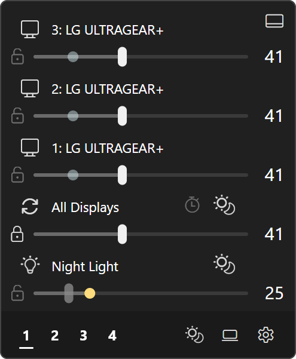
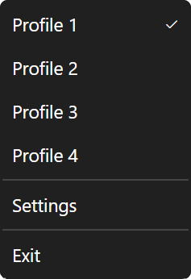

# Brightness

Control the *actual* brightness of external displays over DDC/CI, as well as Windows brightness (laptops) and Windows Night Light.

I kept running into DDC failures with [Twinkle Tray](https://github.com/xanderfrangos/twinkle-tray), and I don't like Electron. I took inspiration from the fluent layout it used, so many thanks to Xander Frangos for that. This was the first "major" TADN app I made, and there are quite a few features.

## Flyout

Left-click the tray icon to open the flyout, click again (or press ++esc++) to hide it. From top to bottom:

- One row per display: icon, name, brightness slider and the current value.
- **All Displays**: the master slider.
- **Night Light**: Windows Night Light on/off and strength.
- The footer: profile buttons on the left, action buttons on the right.

If the app finds nothing it can control, the list just says **No DDC/CI displays detected**.

### Display Rows

Drag a slider to set that display's brightness. You can also scroll over it: one notch is 2% by default (**Mouse wheel step**), and ++ctrl++ + scroll moves 10% per notch. With a slider focused, the arrow keys step 1%, ++page-up++ / ++page-down++ step 10%, and ++home++ / ++end++ jump to 0 / 100.

Click a display's monitor icon to exclude it from the master slider (the tooltip says **Exclude from master** / **Include in master**). An excluded display is parked: its slider is greyed out, and the master slider, sync, **Full bright** / **Full dim**, the tray wheel and the brightness hotkeys all leave it alone. Click the icon again to bring it back.

Two optional extras, both off by default in **Settings** > **Flyout**:

- **Show monitor power buttons**: a power button on each display row that can be powered over DDC/CI. It turns the display off, or back on.
- **Show display number on monitor icons**: puts the Windows display number in front of each name, e.g. `2: LG ULTRAGEAR+`.

Renaming displays, min/max brightness limits, the warning triangle you get when a display's DDC/CI stops responding, and how "power off" is actually sent to the monitor are all on [Displays](displays.md).

### All Displays

The master slider moves every included display by the same amount and keeps the differences between them. Display 1 at 60 and display 2 at 80, drag master up by 10, and you get 70 and 90.

When a display hits 0 or 100 it stops there. By default the differences are measured again from the clamped values the next time you grab the master slider, so pushing everything to 100 and back down leaves all your displays equal (slider offset degeneration). Turn on **Settings** > **Flyout** > **Preserve slider offsets (prevent slider offset degeneration)** to keep the overflow, and the original differences come back when you bring master down again.

When you're not dragging it, the master slider shows the **Average** of the display sliders. **Settings** > **Flyout** > **Master slider tracking** switches that to **Lowest** or **Highest**.

### Brightness Synchronization

The icon next to **All Displays** is the sync button (tooltip **Sync displays**):

- Click: every included display jumps to the master slider's value.
- ++ctrl++ + click: master and every included display jump to the brightest included display.

The **Normalize brightnesses to master** hotkey does the same as a plain click.

The other button on the **All Displays** row toggles the day/night brightness curve. With a curve on, each row also gets a lock button for taking it off the curve by hand (control disengagement). All of that is on [Day/Night Curve](curve.md).

### Night Light Row

The bulb icon turns Night Light on or off and the slider sets its strength. That's Windows Night Light, unless you switched to the **Gamma ramp** backend, where the app draws the tint itself. Its own curve button is the same idea as the brightness one. Everything about it is on [Night Light](night-light.md).

### Footer

- **Profile buttons** (**1** to **4**): click to apply that profile. Hover one and the sliders preview its values without applying anything. The underline marks the active profile, and the tooltip shows its name.
- **Save profile**: only there when **Auto-save** is off. Saves the sliders to the active profile. It's dimmed while there's nothing unsaved.
- **Environmental curves**: turns the brightness and Night Light curves on or off together. If either is on, a click turns both off. See [Day/Night Curve](curve.md).
- **Turn off displays**: off by default (**Settings** > **Flyout** > **Show power button**). Powers off every display that supports it, or only the included ones with **Power button affects only enabled monitors** on.
- **Display settings**: opens **Settings** > **System** > **Display** in Windows.
- **Settings**: opens this app's settings window.

Undocking the flyout, keeping it open, and the update button are the same in every TADN app, see [Tray and Flyouts](../../shared/tray-and-flyouts.md) and [Updates](../../getting-started/updates.md).

## Profiles

There are four profile slots. A profile saves:

- each display's brightness, and whether it's included in the master slider,
- the **Master slider tracking** mode,
- the Night Light strength (not whether Night Light is on),
- that profile's own day/night curves (see [Day/Night Curve](curve.md)).

Saving only adds and updates. A display that's unplugged or off when you save keeps whatever the profile had for it, so it gets its values back when it shows up again.

Ways to switch profiles:

- the footer buttons,
- the number keys ++1++ to ++4++ while the flyout has focus (**Settings** > **Flyout** > **Number keys switch profile in flyout**, on by default),
- the tray right-click menu,
- a **Select profile** hotkey.

A switch is ignored while you're still dragging a slider.

With **Settings** > **General** > **Auto-save** on (the default), every change goes straight into the active profile once you let go of the slider. Turn it off and changes stay unsaved until you hit **Save profile**. ***Switching to another profile without saving throws those changes away.***

**Settings** > **General** > **Apply brightness when app opens** (on by default) re-applies the active profile's brightness and Night Light strength when the app starts. Turn it off and the app starts with whatever your displays are already at. While a curve is on, the curve decides instead.

### Naming and Reordering

**Settings** > **General** > **Profiles** lists the slots. Type a name into a slot's box; it shows up in the flyout tooltip, the tray menu and the hotkey list. Leave it empty (or type `Profile`) to go back to the default name.

The up/down arrows move a profile's saved data (name included) to another slot. The slots themselves stay put, so button **1**, key ++1++ and the **Select profile** hotkey for slot 1 now apply whatever profile you moved there.

## Windows Brightness

Displays that Windows can dim on its own, i.e. the internal panel of a laptop, show up as normal rows next to your DDC/CI monitors. The app sets them through Windows instead of DDC/CI. They get a brightness slider only, no power control. More on [Displays](displays.md).

## Tray Icon

The icon is a sun that gets eclipsed as brightness goes down: a full sun at 100%, a fully eclipsed sun at 0%, and the moon covering more of it in between. Hover it for a tooltip with **Brightness: N%**, plus **Night Light: N%** while Night Light is on.

Icon options are in **Settings** > **Theme** under **Tray icon**:

- **Tray icon style**: **Eclipse (dynamic)** (default) follows brightness. **Eclipse (static)** locks the icon at a 50% eclipse.
- **Dynamic icon brightness tracking**: which brightness the icon shows, **Lowest**, **Average** (default) or **Highest** of your displays.
- **Track only enabled monitor sliders**: ignore excluded displays for the icon. Off by default.
- **Bright color** / **Dim color**: the icon blends from the dim color at 0% to the bright color at 100%. **Static icon color** is the single color for the static style.

Color picking works like everywhere else in the suite, see [Themes](../../shared/themes.md).

### Scroll Wheel and Touchpad

Scroll over the tray icon to change brightness, no need to open anything. Each notch moves every included display by **Mouse wheel step** (2% by default, the same setting as the flyout sliders). Hold ++ctrl++ while scrolling and it changes Night Light strength instead. The tooltip pops up so you can see where you are.

Precision touchpads work too: scroll on the touchpad while the pointer is over the icon. Every **Touchpad sensitivity** units of raw touchpad movement (default `90`, range 1 to 1000) is a 1% step, so lower is more sensitive.

This does *not* use an always-active global mouse hook. The app only listens for wheel and touchpad input while your pointer is actually over the icon.

The switches live in **Settings** > **Tray Icon**: **Mouse wheel** (on), **Mouse wheel step**, **Precision touchpad** (on) and **Touchpad sensitivity**.

### Modified Actions

**Settings** > **Tray Icon** > **Modified actions** assigns what scrolling and clicking do with ++ctrl++ or ++alt++ held, and what a double-click does. Anything set to **Nothing** falls back to the normal behavior.

| Gesture | Default | Options |
| --- | --- | --- |
| **Mouse wheel** | Brightness | **Nothing**, **Brightness**, **Night Light** |
| **Ctrl + mouse wheel** | Night Light | same |
| **Alt + mouse wheel** | Nothing | same |
| **Ctrl + left click** | Nothing (toggles the flyout) | **Nothing**, **All displays OFF**, **All displays ON**, **Full bright**, **Full dim** |
| **Alt + left click** | Nothing | same |
| **Ctrl + right click** | Nothing (opens the menu) | same |
| **Alt + right click** | Nothing | same |
| **Double left click** | Nothing | same |
| **Ctrl + double left click** | Nothing (uses **Double left click**) | same |
| **Alt + double left click** | Nothing (uses **Double left click**) | same |

**Full bright** sets every included display to 100%, **Full dim** to 0%. Run the same action again while they're still there and they go back to where they were. A double-click starts with a normal click, so the flyout still toggles before the double-click action runs.

**All displays ON** sends the power-on command over DDC/CI to every display that supports power control. A display powered off with the hard power-off mode will most likely need its physical power button instead, see [Displays](displays.md).

### Context Menu

Right-click the icon (or ++shift+f10++ / the menu key while it has keyboard focus) for:

- the profiles, with a check mark on the active one (**Show profile selectors**, on),
- **Power off all displays** (**Show all-displays power selector**, on),
- one **Power off <display>** entry per display (**Show individual power selectors**, off),
- **Settings** and **Exit**.

The power entries only show when at least one display supports power control. These switches and **Menu position** are in **Settings** > **Tray Icon** > **Context menu**. The rest of the tray menu customization is shared, see [Tray and Flyouts](../../shared/tray-and-flyouts.md).

## Settings

The settings window works like in every TADN app, see [Settings Window](../../shared/settings-window.md). Pages: **General**, **Flyout**, **Tray Icon**, **Monitor options**, **Hotkeys**, **Environmental**, **Theme** and **About**. **Monitor options** is covered on [Displays](displays.md), **Environmental** on [Day/Night Curve](curve.md). The tray icon settings are above.

### General

App-specific cards on **General**:

| Setting | Default | What it does |
| --- | --- | --- |
| **Apply brightness when app opens** | On | Re-applies the active profile at launch, see [Profiles](#profiles). |
| **Auto-save** | On | Saves every change to the active profile. |
| **Auto-engage environmental curve** | Off | See [Day/Night Curve](curve.md). |
| **Night Light** group | | See [Night Light](night-light.md). |
| **Profiles** | | Rename and reorder profile slots, see [Naming and Reordering](#naming-and-reordering). |

Language, run on startup, installation and rendering are shared, see [Settings Window](../../shared/settings-window.md) and [Installation](../../getting-started/installation.md).

### Flyout

| Setting | Default | What it does |
| --- | --- | --- |
| **Show monitor power buttons** | Off | Power button on each display row. |
| **Show display number on monitor icons** | Off | Puts the Windows display number in front of each display name. |
| **Show display settings button** | On | The **Display settings** footer button. |
| **Show power button** | Off | The **Turn off displays** footer button. |
| **Show master slider** | On | The **All Displays** row, including the sync button. |
| **Show individual sliders** | On | The per-display rows. |
| **Show environmental curves button** | On | The **Environmental curves** footer button. |
| **Show kelvin label on night light slider** | Off | See [Night Light](night-light.md). |
| **Power button affects only enabled monitors** | Off | Footer power button skips excluded displays. |
| **Number keys switch profile in flyout** | On | ++1++ to ++4++ apply profiles while the flyout has focus. |
| **Master slider tracking** | Average | What the master slider shows when you're not dragging it. |
| **Preserve slider offsets (prevent slider offset degeneration)** | Off | See [All Displays](#all-displays). |
| **Mouse wheel step** | 2% | Percent per wheel notch on the flyout sliders and the tray icon (1 to 50). |

**Restore undock state on startup**, **Show undock button** and **Keep undocked flyout on screen** are the shared undock settings, see [Tray and Flyouts](../../shared/tray-and-flyouts.md). The slider thumb shape (**Slider indicator**) and the footer color are on **Theme**, see [Themes](../../shared/themes.md).

## Hotkeys

Rebinding works like in every TADN app, see [Hotkeys](../../shared/hotkeys.md). The **Hotkeys** page has these actions:

| Action | Default | What it does |
| --- | --- | --- |
| **Open flyout** | Unbound | Shows the flyout. |
| **Open settings** | Unbound | Opens the settings window. |
| **Full bright** | ++ctrl+alt+win+f++ | Every included display to 100%. Press again to go back. |
| **Full dim** | Unbound | Every included display to 0%. Press again to go back. |
| **Increment master brightness** | Unbound | Every included display up 2%. |
| **Decrement master brightness** | Unbound | Every included display down 2%. |
| **Normalize brightnesses to master** | Unbound | Same as clicking the sync button. |
| **Toggle night light** | Unbound | Night Light on or off. |
| **Increment night light** | Unbound | Night Light strength up 2%. |
| **Decrement night light** | Unbound | Night Light strength down 2%. |
| **Power off all monitors** | Unbound | Powers off every display that supports it. |
| **Select profile: <name>** | Unbound | One row per profile slot. |
| **Power off specific monitor** | Unbound | One row per target, see below. |

**Full bright** is the only action bound by default. Remove that binding and it stays removed, the app doesn't put it back on the next start.

**Note**: the hotkey steps are a fixed 2%, they don't follow **Mouse wheel step**.

For **Power off specific monitor**, click **Add monitor-off binding** to get a row, then pick the target in its dropdown:

- **Display #N (whichever is plugged in)**: whatever display currently has that Windows number.
- A specific display by name (with **(currently #N)** when it's connected): that physical display, wherever it's plugged in.

**Remove** on the row deletes the target with all of its bindings.

## Known Issues

The **About** page lists two:

- **DDC state corruption**: if a monitor becomes unrecoverable, its slider shows a warning triangle and the monitor has to be power cycled to get DDC back. See [Displays](displays.md).
- **Night Light corruption**: if Night Light becomes unresponsive, press ++ctrl+shift+win+b++ (Windows' graphics driver reset), then sign out and back in. See [Night Light](night-light.md).
