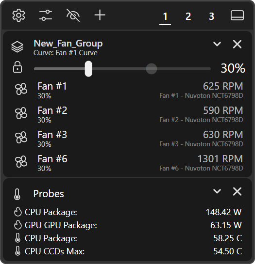

# Fan Control

A tray-based fan controller and hardware monitor. Not to be confused with the very popular "Fan Control" project. I find that app cumbersome, and I find it odd it's not open source. Like Fan Control, this project is essentially a UX wrapper around LibreHardwareMonitor, and nothing more.

## Hardware Access

LibreHardwareMonitor needs the PawnIO driver to talk to motherboard fan controllers. On every launch the app checks for PawnIO 2.0 or newer. The tray icon shows up first; the check, any install and the hardware scan run in the background. If PawnIO is missing or older:

1. The app downloads the official PawnIO 2.1.0 installer from the PawnIO GitHub releases (`namazso/PawnIO.Setup`), unless it's already cached, checks its size and SHA-256, and keeps it in `%LocalAppData%\TrayAppDotNET\Downloads\PawnIO\2.1.0`. The download gives up after two minutes.
2. It runs the installer, which brings up a UAC prompt. The file stays locked against changes from the moment it's checked until the installer has started.
3. The app waits for the installer to finish (at most ten minutes) before it starts reading sensors.

If the download fails (e.g. no internet), the app runs without PawnIO and tries again on the next launch. If you cancel the UAC prompt, the app remembers that and stops asking at every start; **Settings** > **General** then shows a **PawnIO driver** card with an **Install** button for when you change your mind. After installing from there, restart Fan Control to use it. Without PawnIO the motherboard fan headers don't show up, so expect a short or empty fan list.

Uninstalling Fan Control removes the downloaded installer. The PawnIO driver itself stays installed, since other software may use it.

The app itself runs as a normal user. The PawnIO installer is the only thing that asks for admin.

## Flyout

Left-click the tray icon to open the flyout. It's a stack of cards: fan cards, group cards, and probe cards, in whatever order you dragged them into. If nothing shows up at all you get **No fans detected**.

The header, left to right:

- **Settings** (gear): opens the settings window.
- **Fan curve editor**: opens the [curve editor](curve-editor.md) for the first fan that has a curve assigned (or the first fan, if none do). With no fans at all it opens **Settings** > **Fan properties** instead.
- **Show or hide non-functioning fans** (eye): toggles the same setting as **Settings** > **Flyout** > **Show non-functioning fans**. ++ctrl++ + click instead sorts all fans by their hardware name (e.g. Fan #1, Fan #2...).
- **Add item** (+): **Add group card** or **Add probe card**. New cards go to the top.
- **1**, **2**, **3**: [fan profiles](#profiles). The underlined one is active.
- Undock button on the far right. Undocking works like in every TADN app, see [Tray Icon and Flyouts](../../shared/tray-and-flyouts.md).

++esc++ hides the flyout.

### Fan Cards

Every controllable fan LibreHardwareMonitor finds gets a card:

- Fan icon: opens or closes the [Fan Properties](#fan-properties) window for that fan.
- Name: the hardware name (e.g. "Fan #1") until you rename it. Double-click it, or focus it and press ++enter++ or ++space++, to rename inline. ++enter++ or clicking away saves, ++esc++ cancels.
- Below the name: the assigned curve, e.g. **Curve: none** or **Curve: Fan #1 Curve**.
- Top right: the current RPM, and below it the sensor label, e.g. "Fan #1 - Nuvoton NCT6798D". A warning sign shows up left of the RPM when the fan is outside its **Warn low** / **Warn high** range, or when its curve had to hand it back to hardware control. Hover it for the reason. See [Speed Warnings](#speed-warnings) and [When a Curve Can't Run](#when-a-curve-cant-run).
- Mode button (the lock on the left of the slider): toggles between **Manual** and **Curve**. The tooltip tells you which one you're in. It's bright in Manual and dimmed in Curve.
- Slider and value: the speed. Double-click the value to type a number; that also switches the fan to Manual.

Sensors refresh twice a second.

### Control Modes

**Manual**: the slider is the fan speed. Drag it and the app writes that duty cycle to the fan right away, limited to the fan's **Min duty** / **Max duty**. The value is saved, so the fan goes back to it the next time the app starts. **Offset**, **Max delta**, and **Jumpstart** don't apply in Manual.

**Curve**: the app reads the curve's data source twice a second and drives the fan from the curve, see [Curve Control](#curve-control). What the slider shows depends on the curve:

- With a curve that has a data source, the slider shows the curve's value for the current sensor reading, using the **Curve slider thumb** shape. That's the curve before the fan's own **Offset**, **Min duty** / **Max duty**, **Max delta**, and **Jumpstart**, so the fan's real speed can differ; the RPM readout shows what it's actually doing. Dragging the slider does nothing; it snaps back.
- With no curve (or no data source), the slider and value dim and show the fan's actual current duty cycle, i.e. what the BIOS is doing. Same while a curve is paused because its sensor stopped reporting.

New fans start in Curve mode with the **Default assigned curve**, which is **None** unless you change it. So on a fresh install every fan stays on hardware control until you give it a curve or switch it to Manual.

**Show multiple slider values** (**Settings** > **Flyout**) draws the other mode's value as a dimmed second thumb. The default, **Only in manual**, shows the curve's target as a faded marker while you're in Manual.

### RPM Mode

Fans can show their speed in RPM instead of duty cycle %. This is picked when a fan is first discovered, from **Settings** > **General** > **Default to RPM mode**. In Manual, the slider goes from 0 to the highest RPM the app has seen from that fan since it started, so right after launch the range can be short. It's not a closed loop either: the app converts your RPM value to a duty cycle against that maximum and writes the duty cycle, so the fan won't land exactly on the number you picked.

### Curve Control

On every sensor refresh (twice a second), each fan in Curve mode, alone or in a group, goes through these steps:

1. The curve's value for the current reading of its data source. The curve's own **Min duty** / **Max duty** (or **Min RPM** / **Max RPM**) from the [curve editor](curve-editor.md) already apply here.
2. **Offset** is added.
3. The result is held between **Min duty** and **Max duty**.
4. **Max delta** limits how far the speed can move since the last write, scaled by the real time that passed, e.g. 10 %/s allows 5% per half-second refresh. A **Max delta** of 0 means no limit. The first write after the app takes over a fan (startup, switching to Curve, or a curve coming back after a pause) goes straight to the target.
5. **Jumpstart**: if the fan was stopped and the new speed is above 0 but below the fan's **Jumpstart** value, the fan gets the **Jumpstart** speed for one refresh first, then drops to the target. "Stopped" means the app's last write was 0%, or, when the app first takes over, the fan reads 0 RPM (0% if it has no RPM sensor). Skipped when the target is already at or above **Jumpstart**.
6. **Min duty** / **Max duty** once more, as hard limits on what gets written. Neither **Max delta** nor **Jumpstart** can take the fan outside them: a **Jumpstart** above **Max duty** only kicks up to **Max duty**, and raising **Min duty** takes effect on the next refresh instead of ramping up.

Each step works in the curve's unit, i.e. % for a % curve and RPM for an RPM curve, and the fan's property values are converted to that unit first, whatever their own **RPM mode** toggle says. An RPM result is turned into a duty cycle against the highest RPM the app has seen from that fan since it started (before the first reading, the curve's **Max RPM**). The app never writes anything outside 0% to 100%.

In a group, the group's curve drives every fan in it, but each fan still uses its own **Offset**, **Min duty** / **Max duty**, **Max delta**, and **Jumpstart**.

Right after the app starts, it leaves curve fans exactly as they are until the first sensor refresh. A sensor that still hasn't reported by then starts counting toward the 5 seconds below from that first refresh.

### When a Curve Can't Run

A curve-driven fan goes back to hardware control (BIOS or GPU driver) instead of getting a guessed speed when:

- the curve's data source isn't there, e.g. the sensor wasn't found on this boot,
- the sensor returns an invalid reading (not a number),
- the sensor hasn't given a valid reading for 5 seconds, or
- the curve has no points.

The fan card shows the warning sign with the reason, and the slider dims and shows the fan's real duty cycle. As soon as the sensor reports again, the curve picks the fan back up on its own.

One exception: after Fan Control was ended without a clean **Exit** earlier in the same boot (see [Safety](#safety)), hardware control can't be trusted to mean BIOS control. In that case a curve that can't run puts its fan at that fan's **Max duty** instead, until the curve can run again.

### After Sleep or Hibernation

Firmware can reset the fan controller while the PC sleeps. When Windows resumes, Fan Control re-opens the hardware, finds the sensors and fans again, and writes every fan's current setting (Manual value or curve output) once more, so the fans don't stay on whatever the firmware left them at.

### Speed Warnings

**Warn low** and **Warn high** in [Fan Properties](#fan-properties) watch the fan's measured speed, in whatever unit each threshold is set to: a % threshold compares against the duty cycle the header reports, an RPM threshold against the fan's RPM sensor. A fan warns when it's below **Warn low** or above **Warn high**; landing exactly on a threshold doesn't count, so the defaults (0% and 100%) never warn. RPM thresholds do nothing on a fan without an RPM sensor. They work in both Manual and Curve mode and never change the speed.

The speed has to stay out of range for 5 seconds before it counts, which covers a fan spinning up or down. Then:

- The fan card shows the warning sign. Hover it for the reading and the threshold, e.g. "Speed warning: 640 RPM, below Warn Low (800 RPM)".
- The tray shows one notification for that excursion, e.g. "Front is at 640 RPM, below its Warn Low of 800 RPM." Clicking it opens the flyout.

Once the speed has been back in range for 5 seconds the warning clears, and the next time it goes out of range you get a new notification.

### Groups

**Add item** > **Add group card** adds an empty group. Drag fan cards onto it to put them inside; drag a fan back out to take it out of the group.

- The group card has one mode button and one slider for all of its fans. Switching the group to Manual puts every fan in it on the group's value.
- A fan dropped into a group takes on the group's mode (and its manual value, if the group is in Manual).
- Fans inside a group show their name, current duty %, RPM, and sensor label, but no slider of their own.
- The group's curve is set from any of its fans' [Fan Properties](#fan-properties) window. The group card shows it under the group name, e.g. **Curve: Fan #1 Curve**.
- Chevron collapses or expands the group. **X** deletes it after a confirmation ("Fans in this group will be moved out of the group.").
- Rename by double-clicking the name, same as fan cards.

### Probe Cards

Probe cards show sensor readings (temperatures, power, load, clocks, voltages) right in the flyout. See [Probe Cards](probe-cards.md).

### Reordering

Drag any card (fan, group, or probe) to move it. Order is saved per [profile](#profiles).

### Profiles

The **1**, **2**, **3** buttons in the header are three separate fan layouts. Each profile keeps its own:

- Fan names, groups, and card order.
- Each fan's mode, manual speed, and assigned curve.
- Which probe cards are shown (set in the [Probe Card Editor](probe-cards.md)).

Clicking a profile switches to it right away, including fan speeds for any fan that profile has in Manual. Hover a profile button to see its name; there's no rename in the UI, so they read **Profile 1** through **Profile 3**.

Switching away from a profile saves the current fan modes, speeds, and curves into it first. **Note**: if you set `Autosave` to `false` in `settings.xml`, only names, groups, and order get saved on the way out.

## Fan Properties

Click a fan's icon in the flyout to open its **Fan properties** window (titled e.g. "Fan Properties: Front"). It's a small always-on-top window. The pin button in its title bar keeps it open when the flyout closes; a pinned window ignores its close button until you unpin it.

Nothing here applies until you click **Save**.

| Field | What it is |
| --- | --- |
| **Name** | Display name. Empty means the hardware name. |
| **Group** | Group the fan is in, or **None**. |
| **Mode** | **Curve**, **Manual**, or **Detached**. **Detached** tags the fan as non-functioning and hands it back to hardware control. |
| **ID** | The LibreHardwareMonitor sensor path. Read-only. |
| **Sensor** | Fan header and controller, e.g. "Fan #1 - Nuvoton NCT6798D". Read-only. |
| **Jumpstart** | Speed a stopped fan gets for one refresh before dropping to a low curve target, capped at **Max duty**. New fans start at **Default jumpstart duty cycle** (50%). Curve mode only. See [Curve Control](#curve-control). |
| **Max duty** / **Min duty** | Hard limits on every speed the app writes, in Manual and in Curve mode. Defaults 100% and 0%. |
| **Warn low** / **Warn high** | A measured speed below or above these shows a warning. Defaults 0% and 100%, which never warn. See [Speed Warnings](#speed-warnings). |
| **Max delta** | How fast Curve mode can change the speed, in %/s or RPM/s. New fans start at **Default delta max duty cycle** (100 %/s). 0 means no limit. |
| **Offset** | Added to the curve's value before **Min duty** / **Max duty**. Can be negative. Default 0. Curve mode only. |

The **RPM mode** column next to the number fields switches each value between % and RPM, converting the number as it goes.

On the right, pick a curve from the dropdown (or **None**) and click **Edit curve** to open the [curve editor](curve-editor.md). **Edit curve** saves your fields first, creates a curve named after the fan (e.g. "Front Curve") if it doesn't have one, and switches the fan to Curve mode.

**Reset to defaults** clears the name and group, picks **Default assigned curve** (Curve mode if that's set, Manual if it's **None**), resets every number to its default, and saves immediately.

## Tray Icon

A fan glyph in your text color. You can recolor it under **Settings** > **Theme** > **Tray icon color**.

Hovering it shows "FanControlTrayAppDotNET" plus **CPU Temp** and **GPU Temp** lines. Each line uses a temperature sensor from hardware whose LibreHardwareMonitor name contains "CPU" (or "GPU"), preferring one with "Package" in its name. If no hardware name matches, the line is left out.

- Left-click: toggle the flyout.
- Double-click: **Open settings** by default.
- Right-click: menu with **Settings** and **Exit**.

Modifier clicks (++ctrl++ / ++alt++ with left-click, right-click, or double-click) can be set to **Open settings**. See [Tray Icon and Flyouts](../../shared/tray-and-flyouts.md) for how the tray menu and modifier actions work in general.

## Settings

The settings window works like in every TADN app, see [Settings Window](../../shared/settings-window.md). The Fan Control-specific bits:

### General

| Setting | Default | What it does |
| --- | --- | --- |
| **Default to RPM mode** | Off | Newly discovered fans report speeds in RPM instead of duty cycle %. Existing fans keep theirs. |

### Fan Properties

| Setting | Default | What it does |
| --- | --- | --- |
| **Default jumpstart duty cycle** | 50% | Starting **Jumpstart** value for new fans. Existing fans keep theirs. |
| **Default delta max duty cycle** | 100 %/s | Starting **Max delta** value for new fans. Existing fans keep theirs. |
| **Default assigned curve** | None | Curve given to newly discovered fans. **None** leaves them in hardware control. |

**Fan reassignment** lists every live fan as a slot. Drag the cards (or focus one and press ++ctrl+up++ / ++ctrl+down++) to reorder them, then click **Apply swaps**. Each fan's settings (name, group, mode, curve, speed, and the Fan Properties values) move to the slot you dropped them on. Handy when you moved fans to different headers and want the settings to follow the fan, not the header.

**Manually tag fans as non-functioning** has one toggle per live fan. A tagged fan is treated as **Detached**: it's handed back to hardware control and hidden from the flyout when **Show non-functioning fans** is off. The app also flags a fan as non-functioning on its own when the header reports a duty cycle above 0 but 0 RPM (e.g. nothing plugged in).

### Flyout

| Setting | Default | What it does |
| --- | --- | --- |
| **Restore undock state on startup** | On | See [Tray Icon and Flyouts](../../shared/tray-and-flyouts.md). |
| **Show undock button** | On | Shows the undock button. |
| **Keep undocked flyout on screen** | On | Only shown while undocking is allowed. |
| **Show non-functioning fans** | On | Include detached or tagged fans in the flyout. |
| **Show multiple slider values** | Only in manual | **Disabled**, **Enabled**, or **Only in manual**. See [Control Modes](#control-modes). |

Under **Layout**:

| Setting | Default | What it does |
| --- | --- | --- |
| **Card spacing** | 1 | Vertical gap between cards (0 to 48). |
| **Card horizontal inset** | 1 | Left/right gap between cards and the flyout edge (0 to 48). |
| **Title bar card spacing** | 2 | Gap between the header and the first card (0 to 48). |
| **Card borders** | Off | Outline every card. |
| **Hover card border** | Off | Outline only the card under the mouse. |
| **Hide grouped fan card borders** | On | No outlines on fan rows inside a group. |
| **Use group background** | Off | Paint fan rows inside a group with the group card color. |
| **Square title bar corners** | Off | Keep the flyout header square even with rounded corners on. |

### Tray Icon

| Setting | Default | What it does |
| --- | --- | --- |
| **CPU temperature tooltip** | On | Adds the **CPU Temp** line to the tooltip. |
| **GPU temperature tooltip** | On | Adds the **GPU Temp** line to the tooltip. |
| **Context menu position** | Modern | **Classic** or **Modern**. |
| **Double-click** | Open settings | **Nothing** or **Open settings**. **Nothing** shows the flyout. |
| **Ctrl + left-click**, **Alt + left-click**, **Ctrl + right-click**, **Alt + right-click**, **Ctrl + double-click**, **Alt + double-click** | Nothing | **Nothing** or **Open settings**. **Nothing** falls back to the normal click. |

### Theme

Everything here is the shared theme system, see [Themes](../../shared/themes.md). Fan Control adds color overrides for **Flyout background**, **Flyout title bar**, **Fan card**, **Group card**, and **Card border color**, plus two slider shapes:

| Setting | Default | What it does |
| --- | --- | --- |
| **Slider thumb** | Capsule | Thumb shape on sliders in Manual. |
| **Curve slider thumb** | Diamond | Thumb shape on sliders in Curve mode, and on the dimmed second thumb. |

## Hotkeys

Rebindable like in every TADN app, see [Hotkeys](../../shared/hotkeys.md).

| Action | Default |
| --- | --- |
| **Open flyout** | Unbound |
| **Open settings** | Unbound |

All actions start unbound. Older builds bound **Open settings** to ++ctrl+alt+win+s++, the same key [Network](../network/index.md) used, so whichever app started second couldn't register it. Updating removes that binding once, but only if it's still exactly ++ctrl+alt+win+s++; if you bind it again afterwards, it stays.

## Key Bindings

| Where | Key | Action |
| --- | --- | --- |
| Flyout | ++esc++ | Hide the flyout. |
| Flyout, focused name or value | ++enter++ / ++space++ | Start renaming, or typing a speed. |
| Flyout, inline edit box | ++enter++ | Save. |
| Flyout, inline edit box | ++esc++ | Cancel. |
| Tray icon (keyboard focus) | ++enter++ / ++space++ | Show the flyout. |
| Tray icon (keyboard focus) | ++shift+f10++ / ++menu++ | Open the tray menu. |
| **Settings** > **Fan properties**, focused slot | ++ctrl+up++ / ++ctrl+down++ | Move the slot. |

The curve editor and Probe Card Editor have their own keys, listed on [Curve Editor](curve-editor.md) and [Probe Cards](probe-cards.md).

## Safety

!!! warning "Manual speeds stay put"
    A fan in Manual runs at the value you set, no matter how hot things get. Only **Min duty** / **Max duty** limit it. Manual also lets you go all the way down to 0% (unless **Min duty** is higher), which can stop the fan entirely. Don't leave a CPU, pump, or GPU fan on a low manual value under load. [Speed warnings](#speed-warnings) tell you when a fan is out of range, but they never change its speed.

In Curve mode, a missing, invalid, or stuck sensor hands the fan back to hardware control instead of leaving it on a guessed speed, see [When a Curve Can't Run](#when-a-curve-cant-run).

What happens to your fans when the app goes away:

- **Exit** from the tray menu: LibreHardwareMonitor puts every motherboard header and GPU fan the app took over back the way it found them before the app closes. Normally that's BIOS or driver control.
- **Crash** (or the process gets ended): the crash watcher relaunches the app after about a second (see [Crash Recovery](../../shared/crash-recovery.md)). If that happens 5 times within 30 seconds the watcher gives up and shows a message.
- **Gone for good** (the watcher gave up, or you ended the watcher too): nothing resets the fans. A Manual fan stays at its last speed, and a Curve fan stays at the last speed its curve wrote, until you start the app again or the firmware takes over again, e.g. after a reboot.

***A crash leaves fans where they were.*** On motherboard fan headers, fans the crashed instance was driving stay at the last speed it wrote, and only a reboot puts them back on BIOS control. The relaunched app re-applies each fan's saved state on startup: Manual fans go back to their saved speed, and Curve fans with a working curve go back on their curve with the first sensor refresh. Anything the new instance hands to "hardware control" (a fan with no curve, a **Detached** fan, or **Exit**) only returns it to the speed the crashed instance left it at. The app can tell this happened: it keeps a `fan-control-active.marker` file in `%LocalAppData%\TrayAppDotNET` (not moved by `--settings-dir`) while it's driving fans and removes it after a clean **Exit**. If it finds that file from the same boot on startup, a curve that can't run puts its fan at **Max duty** instead of handing it back, and that stays the rule until the next reboot. A shutdown with Windows Fast Startup on doesn't count as a reboot here; only a full restart clears it.

## Supported Hardware

Whatever LibreHardwareMonitor can see and control, the app can. It reads CPU, GPU, motherboard, memory, and fan/pump controllers. Storage and network sensors are turned off, and so are IPMI/BMC and RAM SPD. A fan only gets a card if LibreHardwareMonitor exposes a control for it; fans it can only read RPM from don't show up as cards (their RPM sensors can still be picked as a curve's data source).

If your board's fan chip isn't supported by LibreHardwareMonitor, there's nothing this app can do about it.
