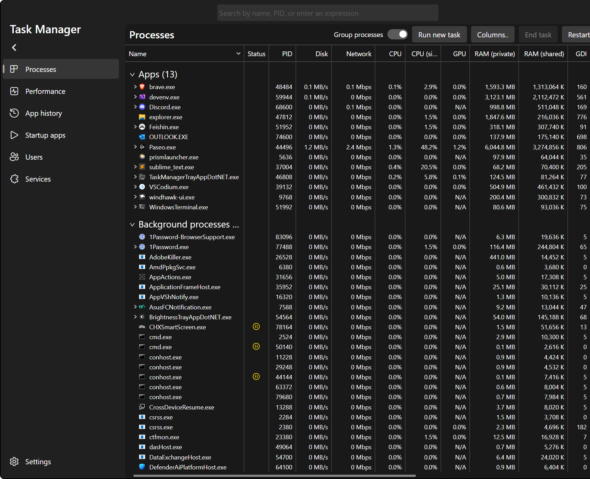
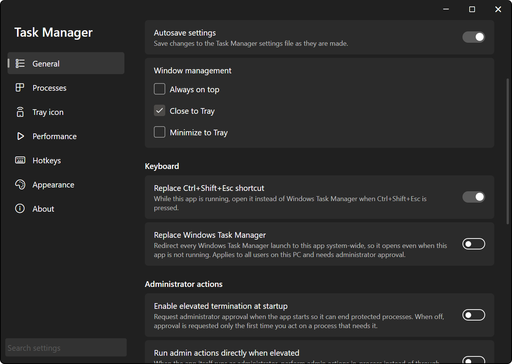
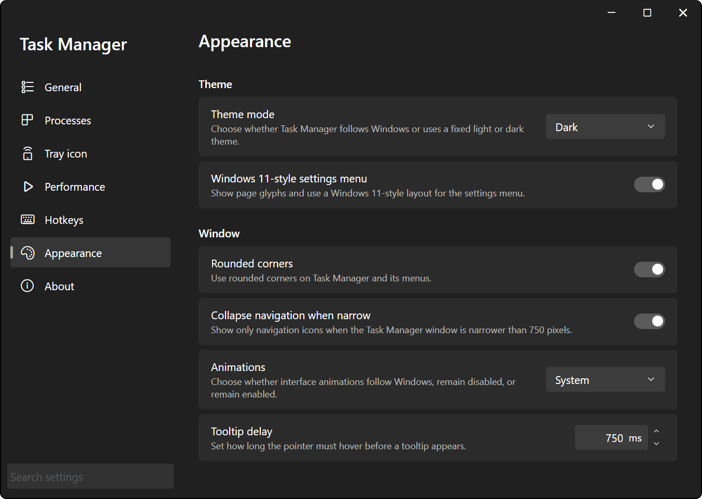

# Task Manager

A "reimplementation" of the Windows 11 Task Manager. The official Task Manager has become far too stuttery for me. While "fixing that", some extra bells and whistles were added.

Unlike the other TADN apps, Task Manager has no flyout. It's a regular window with a live graph as its tray icon, and it keeps running in the tray when you close the window.

## Main Window

The window looks and works like the Windows 11 Task Manager: a navigation sidebar on the left, the selected page on the right.

- **Processes**: the combined processes + details view, with grouping, zoom and stretch, live column totals, multi-select, and a search that understands expressions. See [Processes](processes.md).
- **Performance**: live graphs for the CPU, memory, GPUs, network adapters and disks. See [Performance](performance.md).
- **App history**, **Startup apps**, **Users** and **Services**: the remaining Task Manager pages. See [Other Pages](other-pages.md).
- **Settings** (bottom of the sidebar): opens the separate **Task Manager settings** window.

A few things about the window itself:

- Drag any empty spot above the page content to move the window. Double-click it to maximize or restore.
- The caret above the pages collapses the sidebar to icons only, and expands it again.
- With **Collapse navigation when narrow** on (the default), the sidebar collapses to icons on its own when the window is narrower than 750 pixels.
- An **Update!** button shows up at the bottom of the sidebar when an update is available. See [Updates](../../getting-started/updates.md).

## Tray Icon

The tray icon is a small live graph, drawn in the style of the official Task Manager's icon. It updates once a second, whatever the Performance sampling interval is set to.

Hovering it shows a four-line tooltip:

- **CPU**: overall CPU usage.
- **Memory**: physical memory in use.
- **Disk**: the active time of your busiest disk.
- **Network**: the link utilization of the first network adapter in your [Performance](performance.md) device order.

Mouse and keyboard:

- Left-click toggles the window. If the window was the one you were working in, it hides; if it was hidden, minimized or covered, it comes forward where it was.
- Double-click always brings the window forward.
- Right-click opens the tray menu with **Open Task Manager** and **Exit**.

### Display Modes

Set these in **Settings** > **Tray icon**.

| Setting | Options | Default | What it does |
| --- | --- | --- | --- |
| **Style** | **Current**, **Marquee** | **Marquee** | **Current** fills the icon up to the latest value. **Marquee** draws the last 16 samples as a scrolling line graph, with the newest samples given the most width. |
| **Data source** | **CPU usage (average)**, **CPU usage (highest core)**, **Memory (RAM)** | **CPU usage (average)** | What the graph measures. **Highest Core** is the busiest single logical processor. |
| **Show highest core trace** | On / off | Off | Overlays the busiest logical processor on the average CPU graph. Only applies with **Marquee** and **CPU usage (average)**. |

## Background Mode

Closing the window doesn't exit the app. With **Close to tray** on (the default), the close button just hides the window and the app keeps running in the tray. Use **Exit** in the tray menu to actually quit.

While the window is hidden or minimized, the pages stop doing work: the process list isn't sampled and nothing is drawn. Two things keep running:

- The tray icon graph and its tooltip.
- The Performance history. Every Performance graph keeps recording in the background, so when you open the window the graphs are already full instead of starting from nothing.

The window settings live in **Settings** > **General** > **Window management**:

| Setting | Default | What it does |
| --- | --- | --- |
| **Always on top** | Off | Keeps the Task Manager window (and its settings window) above other windows. |
| **Close to tray** | On | The close button hides the window to the tray. Off makes the close button exit the app. |
| **Minimize to tray** | Off | Minimizing hides the window to the tray instead of leaving it on the taskbar. |

## Startup Behavior

Task Manager is the only TADN app that opens a window when it starts. Which window state you get depends on how it was started:

- Started by you (Start menu, shortcut, double-clicking the exe): the window always opens.
- Started at sign-in by **Run on startup**, with **Start minimized** checked: the window stays out of the way. With **Minimize to tray** on it waits hidden in the tray; otherwise it starts minimized on the taskbar.
- Started with `--hidden` (the installer does this when it finishes): it starts in the tray without a window, whatever the startup settings say. Click the tray icon or press ++ctrl+shift+esc++ (if you've turned that on) to open it.

**Start minimized** is the check box under **Run on startup** in **Settings** > **General**, off by default, and only usable while **Run on startup** is on. It only applies to sign-in launches, which are the ones that carry `--autostart`. See [Launch Arguments](../../getting-started/launch-arguments.md) for both arguments.

## Replacing Windows Task Manager

There are two ways to make Windows open this app instead of its own Task Manager. Both are in **Settings** > **General** > **Keyboard**.

### Replace Ctrl+Shift+Esc Shortcut

**Replace Ctrl+Shift+Esc shortcut**, off by default. While the app is running, ++ctrl+shift+esc++ opens it instead of Windows Task Manager. It's a keyboard hook inside the app, so it only works while the app is running, and it doesn't touch anything system-wide.

### Replace Windows Task Manager

**Replace Windows Task Manager** redirects every Windows Task Manager launch to this app, system-wide: ++ctrl+shift+esc++, the ++ctrl+alt+del++ screen, the taskbar menu, ++win+x++, and running `taskmgr` yourself. It works even when this app isn't running, since Windows starts it for you. If it's already running, the existing window just comes forward.

- Turning it on or off needs administrator approval (a UAC prompt), and it applies to every user on the PC. If you decline, the toggle flips back and nothing changes.
- It needs the system-wide install in Program Files, and the redirect always points at that install. A current-user or portable copy lives in one user's profile, so it can't be what every account's Task Manager opens: without a system install the card is disabled and says so.
- If another program (e.g. Process Explorer) already redirects Task Manager, the card tells you which one. Turning the toggle on points it at this app instead. Turning it off never removes another program's redirect.
- The app decides whether a redirect is its own by the full path of the exe, not just the file name, so turning it off or uninstalling one copy never removes a redirect that points somewhere else.
- Uninstalling the system-wide install removes the redirect for you.

!!! note "Redirects made by older versions"
    Older versions could point the redirect at a current-user install. If yours does, the card shows it as on and lets you turn it off (with administrator approval). A current-user uninstall runs without administrator rights, so it can't remove that redirect itself. Rather than delete the exe Windows would keep sending ++ctrl+shift+esc++ to, the uninstall stops before removing anything and says why: the uninstaller window stays open with the message, and `--uninstall-headless` prints it and exits with code 1. Turn **Replace Windows Task Manager** off, then uninstall again. An uninstall started from an elevated process removes the redirect on its own.

## Administrator Actions

The app itself runs as a normal user, never elevated. A few things Windows only allows administrators to do on some processes, and those go through a separate elevated helper:

- Changing priority or affinity of a protected process (the context menu shows a UAC shield on those entries when it's needed).
- Creating a memory dump of a process the app isn't allowed to read.
- Starting, stopping, restarting or disabling services.
- Enabling or disabling startup apps registered for all users.
- Disconnecting another user's session.

The first time you do one of those and Windows says no, the app asks **Administrator approval required** first, then shows the Windows UAC prompt. Once you approve, the helper sticks around until the app exits, so later actions don't prompt again. Declining changes nothing and isn't remembered: the next admin action asks again.

Ending processes uses its own elevated termination helper, but **End task** and **End task tree** ask on demand the same way: when Windows refuses to end an elevated process and elevated termination isn't on, you get **Administrator approval required** and then UAC, and only the refused processes are ended again after you approve. Declining leaves them running and asks again next time. **Restart explorer** never asks for administrator approval. You can also turn elevated termination on ahead of time from the **More** menu on the Processes page (**Enable elevated termination...**), or have it requested at startup with the setting below. See [Processes](processes.md).

**End task**, **End task tree**, every **Set priority** level and **Disconnect** also have their own confirmation, and it comes first: **Cancel** there means no administrator prompt either. So does disabling a service. Memory dumps, starting, stopping or restarting a service, and startup app changes have no confirmation of their own.

Both settings are in **Settings** > **General** > **Administrator actions**:

| Setting | Default | What it does |
| --- | --- | --- |
| **Enable elevated termination at startup** | Off | Asks for administrator approval as soon as the window first shows, so ending protected processes works right away. When off, approval is requested the first time you end a process that needs it. |
| **Run admin actions directly when elevated** | Off | If you started the app itself as administrator, do admin actions in the app instead of through the elevated helper. Off keeps behavior the same whether or not the app is elevated. |

## Settings

Open them with **Settings** at the bottom of the sidebar. The settings window has the same search and the same shared **General** cards (language, run on startup, installation, rendering) as every TADN app, see [Settings Window](../../shared/settings-window.md). The Task Manager specific settings:

| Page | Setting | Default |
| --- | --- | --- |
| **General** | **Autosave settings**: also save changes made outside the settings window (such as column widths and layout) and save at exit. Changes in the settings window are always saved. See [Autosave](../../getting-started/configuration.md#autosave) | On |
| **General** | **Window management** | See [Background Mode](#background-mode) |
| **General** | **Replace Ctrl+Shift+Esc shortcut**, **Replace Windows Task Manager** | Off, see [above](#replacing-windows-task-manager) |
| **General** | **Administrator actions** | See [Administrator Actions](#administrator-actions) |
| **Processes** | Grouping, zoom and stretch, live totals, columns and search | See [Processes](processes.md) |
| **Tray icon** | **Style**, **Data source**, **Show highest core trace** | See [Display Modes](#display-modes) |
| **Performance** | History, sampling, graphs, device order, hardware names | See [Performance](performance.md) |
| **Hotkeys** | A read-only list of the table mouse and key gestures | See [Processes](processes.md) |
| **Appearance** | See below | |

### Appearance

All of these are on **Settings** > **Appearance**. The first group is the shared one every TADN app has, see [Themes](../../shared/themes.md).

| Setting | Default | What it does |
| --- | --- | --- |
| **Theme style** | **System** | Follow Windows, or force **Light** or **Dark**. |
| **Windows 11-style settings menu** | On | The settings window navigation style. |
| **Text color**, **Background color** | App default | Override the window text and background colors, with separate light and dark variants. |
| **Rounded corners** | On | Rounded corners on Task Manager and its menus. |
| **Animations** | **System** | Follow Windows, or keep animations **Disabled** or **Enabled**. |
| **Tooltip delay** | 750 ms | How long the pointer must hover before a tooltip appears (0 to 10,000 ms). |
| **Font size** (**Context menu**) | 15 | Size of the menus inside the window (8 to 48). The tray menu keeps its fixed size. |
| **Collapse navigation when narrow** (**Window**) | On | Show only navigation icons when the window is narrower than 750 pixels. |

## Key Bindings

Window-level bindings. The process table and the other tables have their own (zoom, stretch, ++delete++ to end a task, etc.), see [Processes](processes.md). The Performance page bindings are on [Performance](performance.md).

None of these are rebindable.

| Where | Input | Action |
| --- | --- | --- |
| Anywhere | ++ctrl+shift+esc++ | Open Task Manager, when **Replace Ctrl+Shift+Esc shortcut** or **Replace Windows Task Manager** is on |
| Tray icon | Click | Show or hide the window |
| Tray icon | Double-click | Bring the window forward |
| Tray icon | ++enter++ or ++space++ (icon focused) | Same as a click |
| Tray icon | Right-click, ++shift+f10++ or the Menu key (icon focused) | Open the tray menu |
| Update notification | Click | Open the window |
| Window, above the page content | Drag | Move the window |
| Window, above the page content | Double-click | Maximize or restore |
