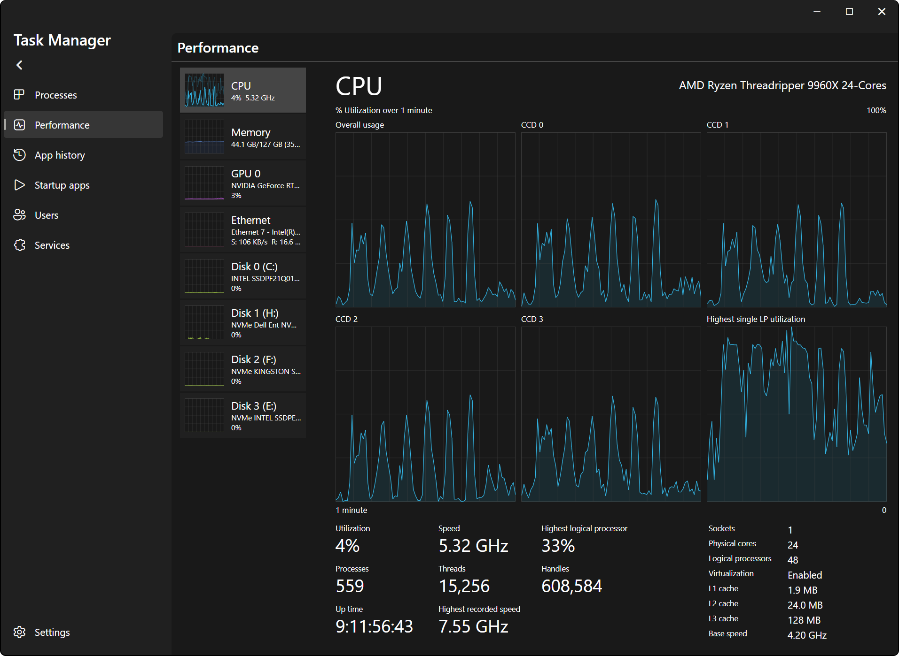
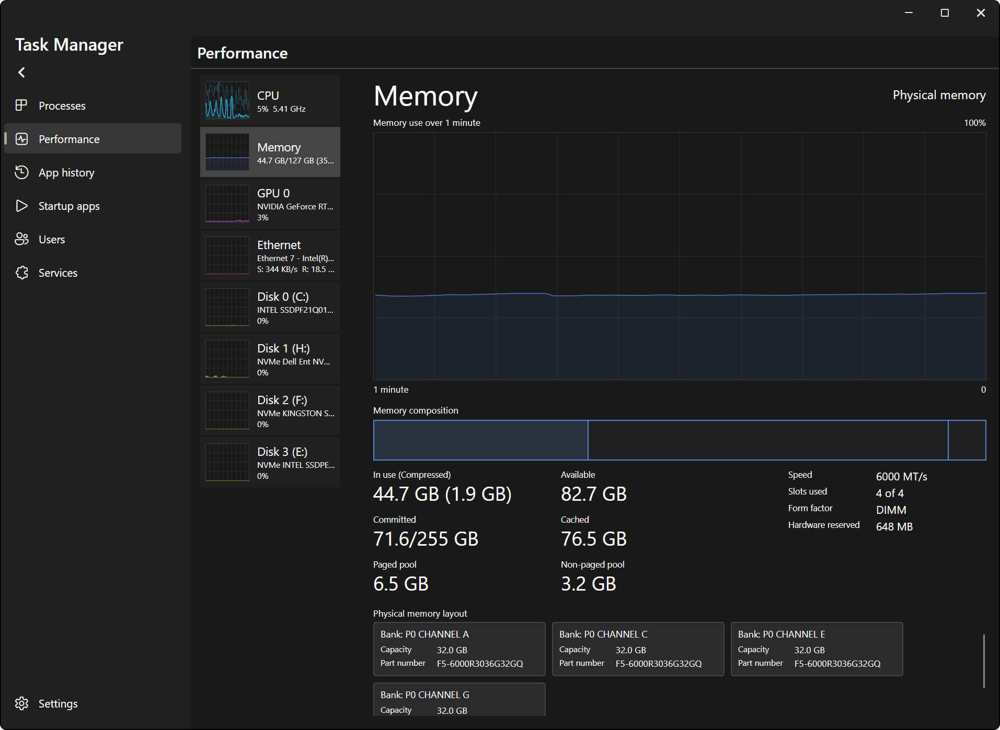
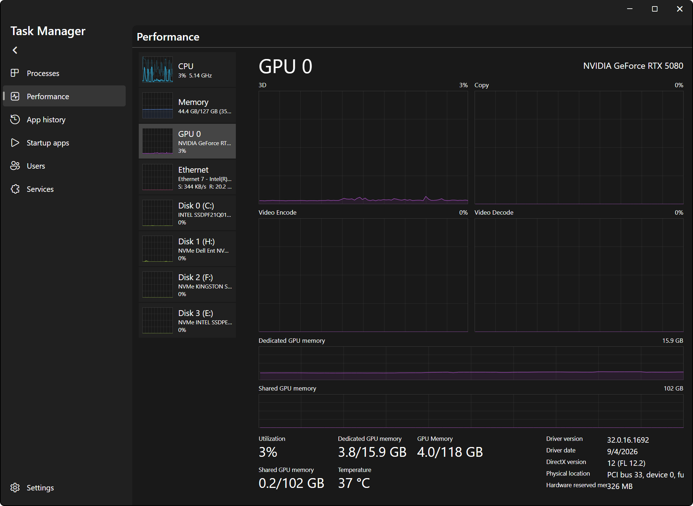
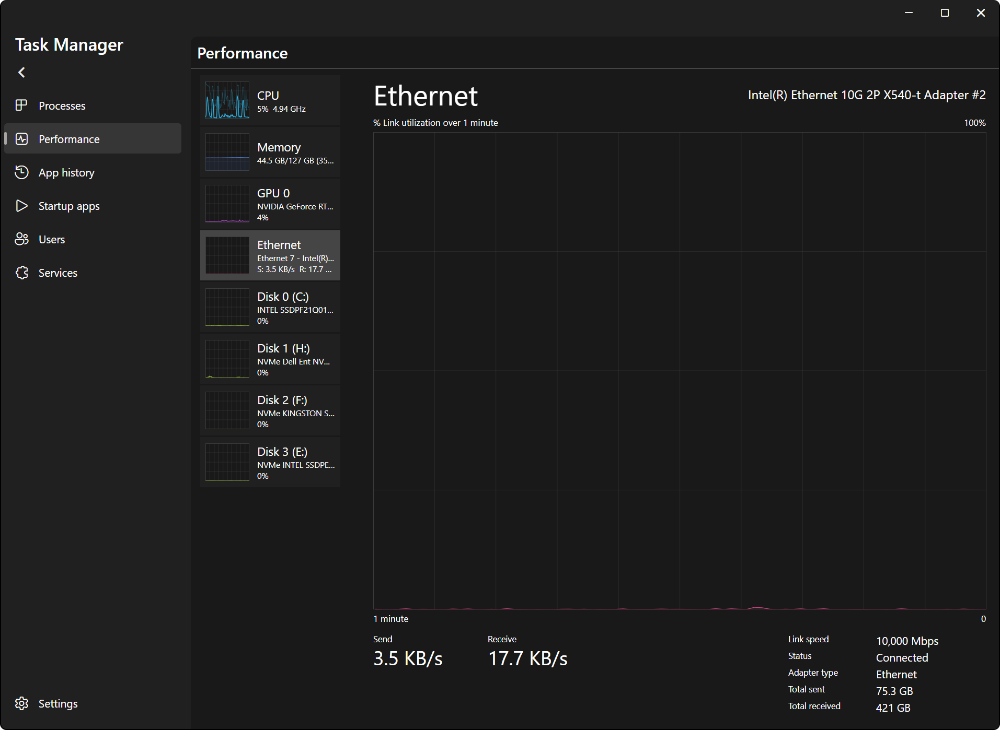
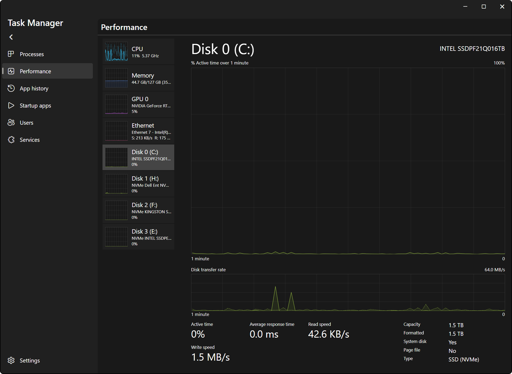
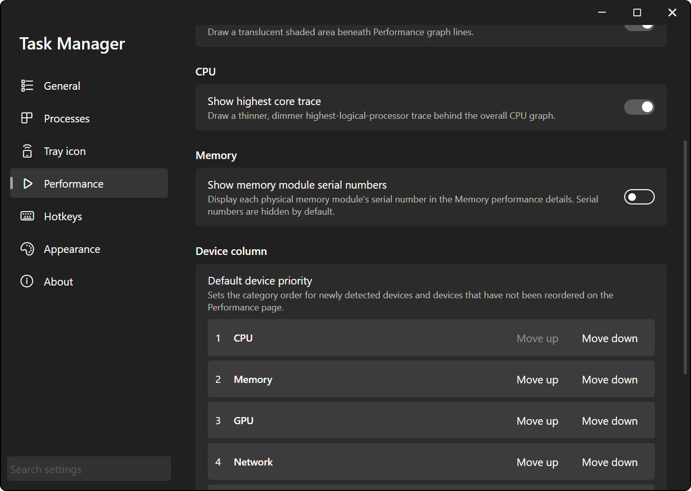

# Performance

The Performance page: live graphs for your CPU, memory, GPUs, network adapters and disks, laid out like the Windows 11 one. On top of that you get preview graphs you can reorder, a live cursor on every graph, single core metrics, per-CCD and per-core-class CPU graphs, and the physical memory layout.

Every value is read straight from Windows. Nothing is copied from, or calibrated against, Windows Task Manager, so small differences between the two are normal (sample timing, which adapters are listed, etc.).

## Device List

The column on the left lists every device, each with a small preview graph, its name and a short summary (e.g. `1%  5.26 GHz` for the CPU, `2%  37 °C` for a GPU whose driver reports its temperature, `S: 84 B/s  R: 195 B/s` for a network adapter). Click a device to show its details on the right.

The device types:

- **CPU**: always one row for the whole processor.
- **Memory**: always one row. Its second line shows memory in use and the total (e.g. `12.0 GB/31.9 GB`), its third line the free (available) memory and how much is in use (e.g. `19.0 GB free (39% used)`).
- **GPU 0**, **GPU 1**, ...: one row per physical GPU.
- **Ethernet**, **Wi-Fi**, **VPN** or **Network**: one row per connected network adapter.
- **Disk 0 (C:)**, **Disk 1 (D:, E:)**, ...: one row per physical disk, with its drive letters.

Devices come and go live. When one disappears (e.g. you unplug a USB drive), its row and its graph history go away. Its spot in your order is remembered, so it comes back where it was.

### Reordering Devices

Drag a device up or down to move it. From the keyboard, focus a device and press ++ctrl+up++ or ++ctrl+down++. The order is saved right away.

Devices you haven't moved yourself, including newly detected ones, are placed by category using **Default device priority** in **Settings** > **Performance** > **Device column**. The default is CPU, Memory, GPU, Network, Disk. Use **Move up** and **Move down** to change it.

- **Reset default priority** puts the categories back in the default order.
- **Clear dragged device order** forgets every drag, so everything falls back to the category priority.

**Note**: a drag saves the order of every device that's listed at that moment. After your first drag, the category priority only affects devices that show up later. Use **Clear dragged device order** if you want the priority to take over again.

## Graphs

Every graph shows the last **History length** of data, 1 minute by default. The label above the graph says what it measures (e.g. `% Utilization over 1 minute`), with the scale on the right and the time span below.

History is recorded from the moment the app starts, in the background, even while the window is hidden or another page is open. Opening the Performance page shows the full history right away instead of starting empty.

### Small Windows

In a narrow window, the large statistics under the graph wrap beside the list on the right and then use the full width below it; when not even one fits beside the list, the list moves below them. When the window gets so short that the graphs would be squeezed, the title and the statistics switch to smaller text to give the graphs their height back, and return to full size once there is room again. In a window too small even for that, the graphs shrink rather than overlap the text.

### Live Cursor

Hover any graph, including the small preview graphs in the device list, and a dashed line follows the cursor with the value of the nearest sample next to it. Turn off **Move graph hover line freely** (see [Settings](#settings)) to lock the line to that sample instead. What it shows depends on the graph:

| Graph | Hover shows |
| --- | --- |
| CPU, overall utilization | `Highest LP` and `Overall util` at that moment |
| Memory | Memory in use (`14.1 G` style on the preview graph) |
| Network | `Send` and `Receive` rates (`S:` and `R:` on the preview graph) |
| Disk | Read and write rates (`R:` and `W:`) |
| Everything else | The graph's own value, in % |

## CPU

The header shows the processor name. Below the graph:

- **Utilization**, **Speed**, **Power**, **Highest logical processor**, **Processes**, **Threads**, **Handles**, **Up time**, **Highest recorded speed**
- **Sockets**, **Physical cores**, **Logical processors**, **Virtualization**, **L1 cache**, **L2 cache**, **L3 cache**, **Base speed**

**Highest logical processor** is the busiest single logical processor right now. The average **Utilization** hides a single-threaded app pegging one core on a CPU with a lot of them; this doesn't.

**Processes**, **Threads** and **Handles** are counted the same way Windows Task Manager counts them. Counting them means walking the whole process list every sample, so they're only measured while the Performance page is on screen and read `Unavailable` until the first sample after you open it.

### Speed

- **Speed** is the same measurement Windows Task Manager shows: the clock the processor actually ran at while busy, averaged over all logical processors. Idle time doesn't lower it, and one fast core gets diluted by the rest, so single cores can run well above it.
- **Highest recorded speed** is the highest **Speed** seen since the app started.
- **Base speed** is read directly from Windows.

When the CPU is nearly idle, **Speed** waits until enough busy time has piled up to give a meaningful number, and keeps showing the previous value until then. It can be a bit stale on an idle machine, but it's never made up.

### Power

**Power** is the CPU package power over the last sample, the figure HWiNFO shows as "CPU Package Power". It comes from the energy counters Windows' processor power driver publishes through its Energy Meter Interface (the `RAPL_Package0_PKG` channel, or the socket channel on AMD APUs), read the way Chromium reads them, so it needs neither administrator rights nor an extra driver. It is the processor's own estimate, not a measurement at the wall. After sleep, or a gap of more than four sample intervals (at least five seconds), the next sample only restarts the measurement. It reads `Unavailable` where Windows publishes no package channel, such as in most virtual machines.

### CPU Graph Views

Right-click the CPU graph to pick a view. The choice is saved.

- **Logical processors** (default): one small graph per logical processor.
- **Overall utilization**: one graph for the whole CPU.
- **Detailed view**: one graph each for overall usage, every CCD, every core class, and the single busiest logical processor.

**Show highest core trace** (**Settings** > **Performance** > **CPU**, off by default) draws the busiest logical processor as a thinner, dimmer line behind the overall graph, in **Overall utilization** and on the CPU preview graph.

### Detailed View

The Detailed view always has **Overall usage** first and **Highest single LP utilization** last. In between, it adds whatever your processor's layout supports:

- **CCD graphs**, AMD processors with more than one CCD only: `CCD 0`, `CCD 1`, etc., each averaging the logical processors on that die. When the CCDs report different L3 cache sizes, the labels include them, and the bigger-cache CCD is marked X3D, e.g. `CCD 0 (X3D, 96.0 MB L3)` and `CCD 1 (32.0 MB L3)`.
- **Core class graphs**, hybrid processors only: e.g. `8 Performance Cores`, `8 Efficiency Cores`, `2 Low Power Efficiency Cores`. The core types are spelled out because "LP" already means logical processor in this view.

On a processor that has neither (one CCD, all cores the same), the Detailed view is just the overall and busiest-core graphs.

Both come from what Windows itself reports about the processor layout. Nothing is guessed from the processor's model name, so if Windows doesn't report a clean layout, those graphs are left out instead of made up. This works without admin rights and without any vendor driver.

**Note**: Windows only ranks core classes, it doesn't name them. The highest class is called Performance cores, cores outside the L3 cache are called Low Power Efficiency cores, and the rest are Efficiency cores. If a processor reports more than two classes, the lower ones get their class number added, e.g. `4 Efficiency Cores (class 1)`.

*Detailed view on a Threadripper 9960X: overall usage, one graph per CCD, and the busiest logical processor.*

## Memory

The header shows the memory error count where other devices show their name (see [Memory Errors](#memory-errors)). The graph shows `Memory use over 1 minute`.

Under it, taking about a third of the graph area, `Page file use over 1 minute` draws one line per page file, each as a percentage of that file's current size. The first page file uses the memory blue and every further one a lighter shade. The row below the graph names them, e.g. `Pagefile H: 7.9 / 40.2GB` (drive, in use, current size on disk); hover an entry for the page file's path, or the graph for each file's use at that moment. Without a page file the memory graph takes the whole area.

Below the graphs:

- **Memory composition**: a bar split into **In use**, **Modified**, **Standby** and **Free**, each segment named above the bar with a tick pointing at it. Hover a segment for its size in MB and what it means. The **In use** tooltip also shows how much is compressed and how much memory that saves.
- **In use (Compressed)**, **Available**, **Committed**, **Cached**, **Paged pool**, **Non-paged pool**
- **Speed** (in MT/s), **Slots used**, **Form factor**, **Hardware reserved**, **Firmware latency**, **Firmware bandwidth**

**Firmware latency** and **Firmware bandwidth** are the figures the firmware declares for the memory in its ACPI HMAT table. They're the board vendor's nominal numbers, not measurements, and they aren't memory timings. Many desktop boards don't publish the table, and then the two lines are left out. When the firmware gives separate read and write figures instead of one, both are shown; several NUMA nodes show a range.

### Memory Errors

**Memory errors: N** counts the memory errors Windows recorded in the System event log since your last reset: corrected and uncorrected errors reported by the hardware (WHEA events 22, 23 and 46 to 49), and failed Windows Memory Diagnostic runs (event 1102). An uncorrected error usually crashes the machine, so it's logged after the restart. The label turns red while the count isn't zero, and new errors show up as Windows logs them. No administrator rights are needed.

The two buttons left of the label:

- The info button opens the error log: every memory error in the System log, newest first, with its time, kind, event ID and the message Windows recorded.
- The reset button (circular arrow) asks for confirmation, then sets the count back to zero. Windows can't delete single events, so the errors stay in the System log and in the error log, dimmed; only errors logged after the reset are counted. It's greyed out while the count is zero.

### Physical Memory Layout

Under the stats, one card per installed memory stick, with its **Bank**, **Capacity** and **Part number**. Scroll it with the mouse wheel when there are more cards than fit.

Serial numbers are hidden by default. Turn on **Show memory module serial numbers** in **Settings** > **Performance** > **Memory** to add a **Serial number** line to every card. While it's off, the serial numbers aren't even read.

## GPU

Each physical GPU gets one row, even if Windows lists it several times. The device row and the main utilization number follow the busiest engine, not the sum of all engines.

Selecting a GPU shows its graphs two to a row, with dedicated memory across the bottom, instead of the single big graph:

- The first two engines your GPU reports, usually **3D** and **Copy**, each on its own graph. When it doesn't report enough engines, they're filled in with **3D**, **Copy**, **Video Decode** and **Video Encode**.
- **Video Decode / Encode**: decode as a solid line, encode as a dashed line in a lighter magenta. The header shows both, decode first.
- **Power**: what the board draws, as a percentage of its default power limit, or in watts once you turn that on (see below).
- **GPU clock** and **Memory clock**, in MHz. The GPU clock graph tops out at the driver's maximum clock or the highest clock seen, whichever is higher; the memory clock graph at the highest memory clock seen.
- **Dedicated GPU memory**, against the card's installed memory, which the header shows.

A graph only appears once its metric has a sample, so a GPU whose driver doesn't report power or clocks, or that lacks an engine, shows no empty graph for it. The graphs left close up, and one that stops reporting goes away once its last sample leaves the graph.

Stats: **Utilization**, **Dedicated GPU memory**, **Shared GPU memory**, **Temperature**, **Power**, **GPU clock**, **Memory clock**, **Max GPU clock**, **Driver version**, **Driver date**, **DirectX version**, **vBIOS version**, **Device ID**, **PCIe link**, **Physical location**, **Hardware reserved memory**.

- The clocks come from Windows (the driver's per-engine and adapter performance data), not from a vendor library, and matched `nvidia-smi` on an RTX 5080. **Max GPU clock** is the maximum the driver reports; GPU Boost can run above it (3,210 MHz against a reported 3,090 MHz on that card).

- **Driver version** is the version the vendor publishes, followed by the Windows version when they differ: `616.92 (32.0.16.1692)`. NVIDIA's comes from the Windows version, AMD's Adrenalin release from the driver's registry key (`RadeonSoftwareVersion`, or `Catalyst_Version` on older packages), and Intel's is the last two fields of the Windows version: `101.6913 (32.0.101.6913)`.
- **vBIOS version** comes from the driver's `HardwareInformation.BiosString`. NVIDIA's is shown the way its tools print it (`98.03.3B.C0.AB`); other vendors' strings are shown as written.
- **Device ID** is the vendor and device, then the subsystem vendor and subsystem and the revision: `10DE:2C02 (1771:2096, rev A1)`.
- **PCIe link** is the generation and lane count, with the maximum added when the link runs below it: `Gen 4 x8 (max Gen 5 x16)`. Windows publishes the link only for the GPU itself, not for PCIe root or switch ports. A GPU behind a PCIe switch on its own card, as AMD's discrete GPUs are, therefore shows its link to that switch, not the slot's, marked `(to on-card switch)`.

### Power in Watts

Windows reports GPU power as a percentage of the board's default power limit, not in watts. Right-click a GPU's graphs and choose **Show power in watts** to read that limit once through the monitoring library the GPU's driver installs: `nvml.dll` for NVIDIA, `amdadlx64.dll` for AMD, `ControlLib.dll` for Intel. The read runs in a separate short-lived process, so the vendor library is never loaded into Task Manager itself. The limit is saved with the GPU and the vBIOS it was read under, and power is shown in watts from then on. Choosing the entry again switches back to the percentage.

- The entry is greyed out, with the reason in its tooltip, when the driver doesn't report power, when the GPU's vendor has no supported library, or when its library isn't installed.
- A saved limit is dropped when the GPU's vBIOS changes, since that is what changes a board's default limit, and power goes back to a percentage until you read it again. Raising or lowering the power limit in a tool such as MSI Afterburner doesn't affect it: the percentage is always of the default limit, so the watts stay right.
- Only NVIDIA has been checked on real hardware. On an RTX 5080, Windows' percentage times NVML's default limit matched `nvidia-smi`'s power draw within about 1.5 W, including with the limit lowered from 360 W to 300 W. Whether AMD and Intel drivers also report a percentage of the default limit is not confirmed, and the AMD reader uses ADLX's maximum total board power, which has not been confirmed to equal the default limit.
- The **PCIe link** is read with the rest of the GPU's metadata, every five minutes. Whether Windows updates the current link speed when the GPU drops to a lower PCIe generation at idle is not confirmed.

## Network

The graph shows `% Link utilization over 1 minute`: the higher of send and receive, as a percentage of the adapter's link speed.

Stats: **Send**, **Receive**, **Link speed**, **Status**, **Adapter type**, **Total sent**, **Total received**.

Only real, connected adapters are listed. Loopback, tunnels, filter drivers and most virtual adapters are left out. ***A real network card that's unplugged or disconnected is hidden too***, until it connects again.

## Disks

Disk rows are titled by physical disk number and drive letters, e.g. `Disk 0 (C:)`, with the drive model under it. Disks without a drive letter are listed too.

The main graph shows `% Active time over 1 minute`. Below it, **Disk transfer rate** graphs read (R) and write (W) speed, with a scale that adjusts to the busiest moment on screen.

Stats: **Active time**, **Average response time**, **Read speed**, **Write speed**, **Capacity**, **Formatted**, **System disk**, **Page file**, **Type**.

## Settings

All in **Settings** > **Performance**.

| Section | Setting | Default | What it does |
| --- | --- | --- | --- |
| **History and sampling** | **History length** | 1 min | How many minutes every graph keeps, 1 to 60. |
| **History and sampling** | **Sampling interval** | 1000 ms | Time between samples, 1 to 60,000 ms. |
| **Graphs** | **Fill graph areas** | On | Shaded area under the graph lines. |
| **Graphs** | **Move graph hover line freely** | On | The hover line follows the cursor instead of locking to the nearest sample. See [Live Cursor](#live-cursor). |
| **CPU** | **Show highest core trace** | Off | See [CPU Graph Views](#cpu-graph-views). |
| **Memory** | **Show memory module serial numbers** | Off | See [Physical Memory Layout](#physical-memory-layout). |
| **Device column** | **Default device priority** | CPU, Memory, GPU, Network, Disk | See [Reordering Devices](#reordering-devices). |
| **Hardware names** | **Hardware name replacements** | None | See below. |

Changing **History length** or **Sampling interval** redraws the graphs from the history that's already recorded instead of starting over.

**Note**: the tray icon graph doesn't use these. It always samples once a second, see [Tray Icon](index.md#tray-icon).

### Hardware Name Replacements

Replacement rules rewrite the hardware names Windows reports, e.g. to shorten a long adapter description.

Click **+ Add replacement**, then fill in the row:

- The device type the rule applies to: **CPU**, **GPU**, **Network** or **Disk**. New rules start as **Network**.
- **Regex match**: a .NET regular expression, matched case-insensitively against the hardware name.
- **Replacement**: the text to put in its place. `$1` or `${name}` inserts a capture group.

Rules run top to bottom, and each one works on the result of the previous one. Changes show up on the Performance page as you type. Delete a rule with the X at the end of its row.

What gets renamed is the hardware name: the processor name, the GPU name, the adapter description for network, and the drive model for disks. Memory has no hardware name (its header shows the memory error count), so there are no memory rules. The `CPU` / `GPU 0` / `Disk 0 (C:)` titles stay as they are.

**Note**: a rule with an invalid regex is ignored, and a rule that fails or times out while running is switched off until the rules change. Both are written to the Task Manager log.

## Key Bindings

| Where | Input | Action |
| --- | --- | --- |
| Device list | Click | Show that device's details |
| Device list | Drag | Move the device |
| Device list | ++enter++ or ++space++ | Show the focused device's details |
| Device list | ++ctrl+up++ / ++ctrl+down++ | Move the focused device up or down |
| CPU graph | Right-click | Pick the CPU graph view |
| Memory layout | Scroll wheel | Scroll the memory cards |
| Any graph | Hover | Live cursor |
