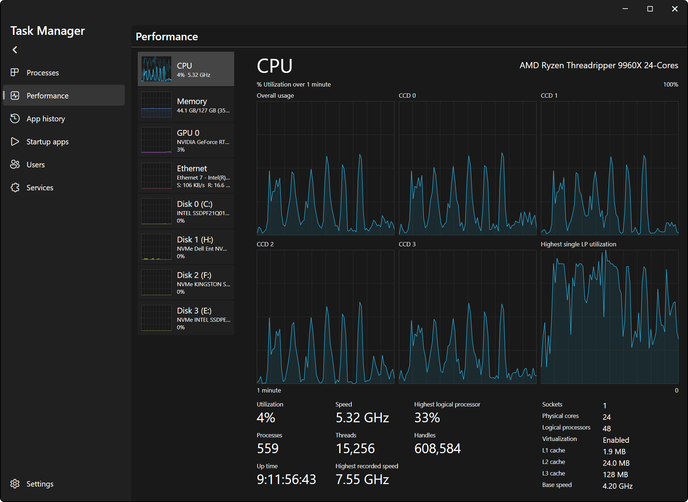
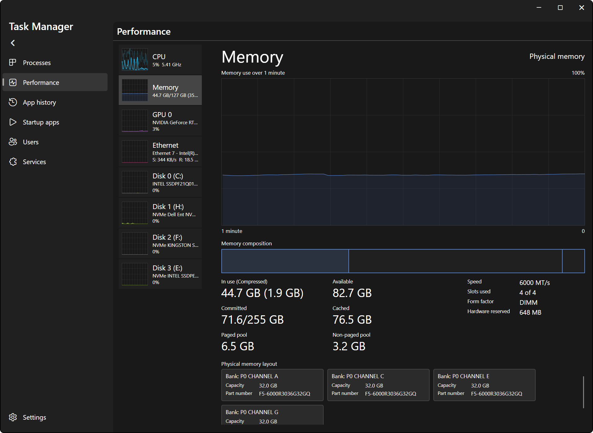
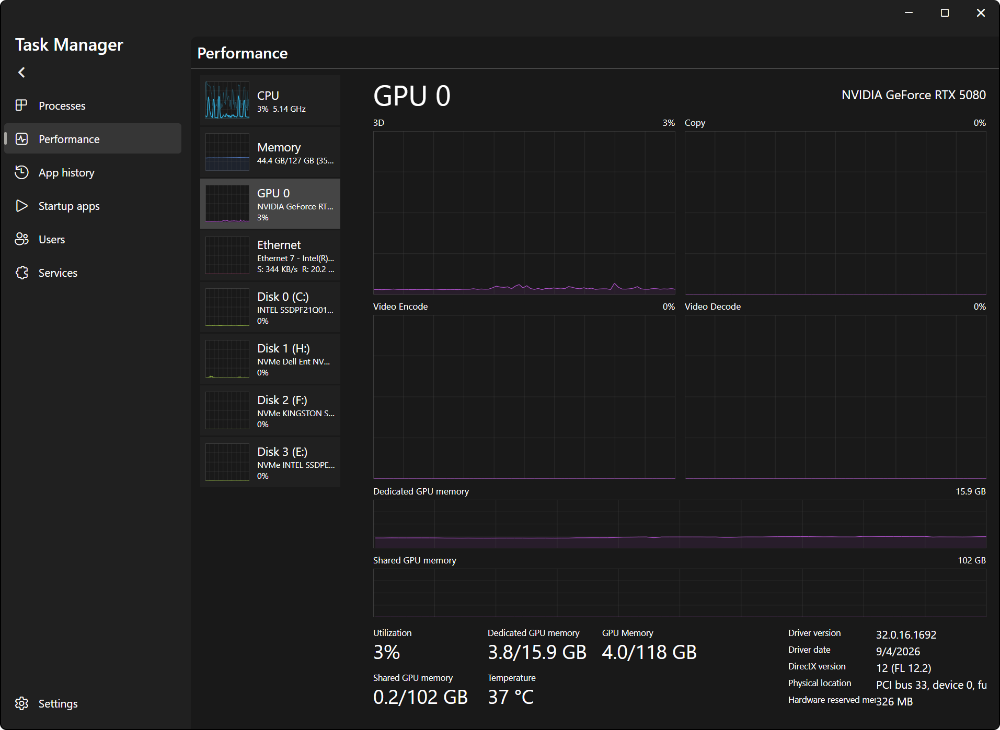
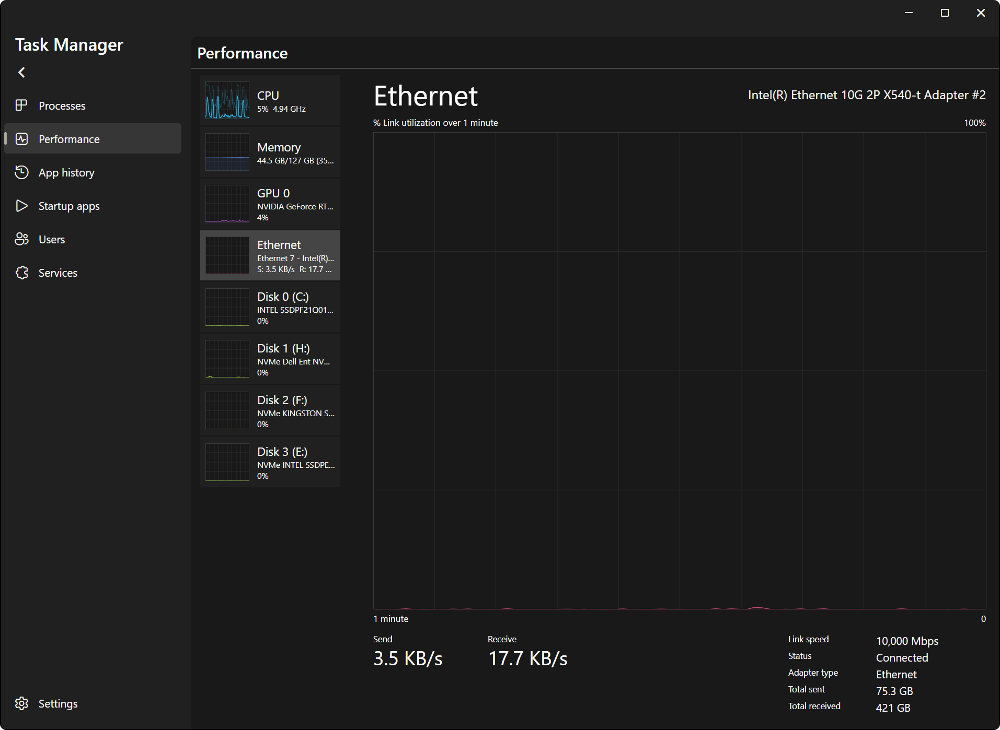
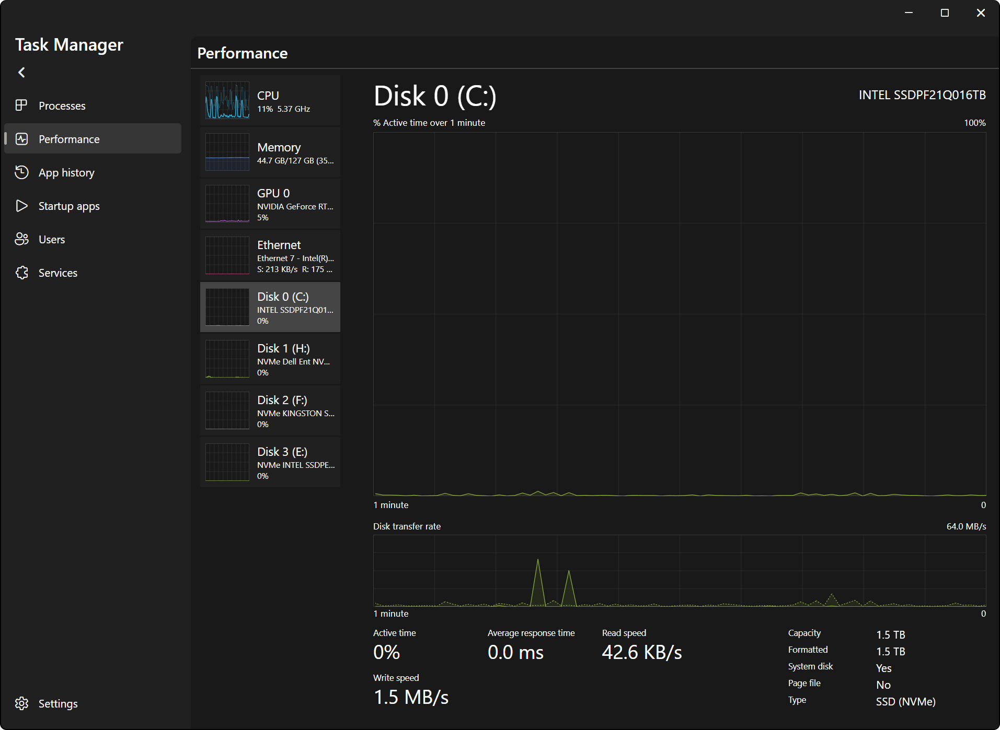
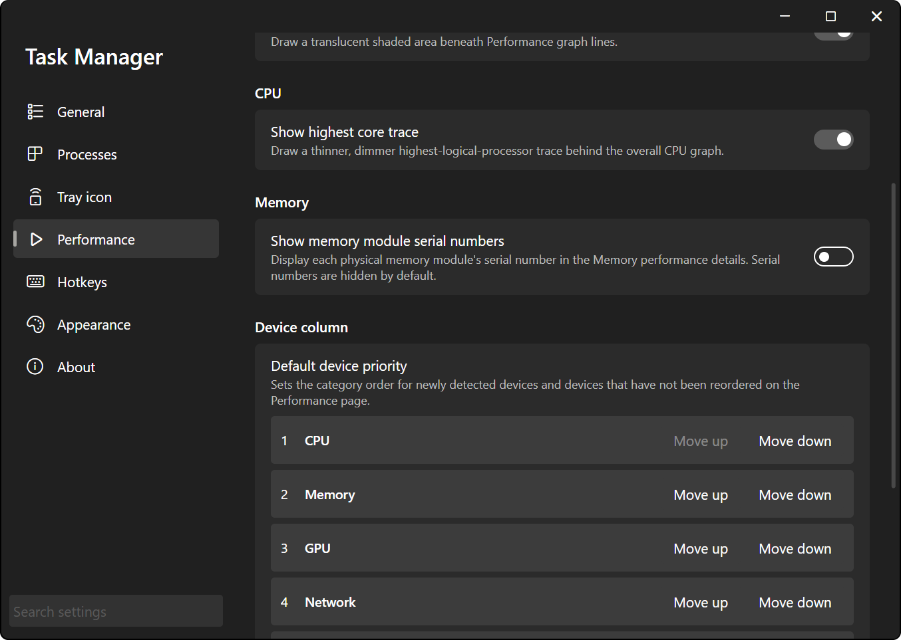

# Performance

The Performance page: live graphs for your CPU, memory, GPUs, network adapters and disks, laid out like the Windows 11 one. On top of that you get preview graphs you can reorder, a live cursor on every graph, single core metrics, per-CCD and per-core-class CPU graphs, and the physical memory layout.

Every value is read straight from Windows. Nothing is copied from, or calibrated against, Windows Task Manager, so small differences between the two are normal (sample timing, which adapters are listed, etc.).

## Device List

The column on the left lists every device, each with a small preview graph, its name and a short summary (e.g. `1%  5.26 GHz` for the CPU, `S: 84 B/s  R: 195 B/s` for a network adapter). Click a device to show its details on the right.

The device types:

- **CPU**: always one row for the whole processor.
- **Memory**: always one row. Its second line shows memory in use and the total (e.g. `12.0 GB/31.9 GB`), its third line the free (available) memory and how much is in use (e.g. `19.0 GB free (39% used)`).
- **GPU 0**, **GPU 1**, ...: one row per physical GPU.
- **Ethernet**, **Wi-Fi**, **VPN** or **Network**: one row per connected network adapter.
- **Disk 0 (C:)**, **Disk 1 (D:, E:)**, ...: one row per physical disk, with its drive letters.

Devices come and go live. When one disappears (e.g. you unplug a USB drive), its row and its graph history go away. Its spot in your order is remembered, so it comes back where it was.

### Reordering Devices

Drag a device up or down to move it. From the keyboard, focus a device and press ++ctrl+up++ or ++ctrl+down++. The order is saved right away.

Devices you haven't moved yourself, including newly detected ones, are placed by category using **Default device priority** in **Settings** > **Performance** > **Device column**. The default is CPU, Memory, GPU, Network, Disk. Use **Move up** and **Move down** to change it.

- **Reset default priority** puts the categories back in the default order.
- **Clear dragged device order** forgets every drag, so everything falls back to the category priority.

**Note**: a drag saves the order of every device that's listed at that moment. After your first drag, the category priority only affects devices that show up later. Use **Clear dragged device order** if you want the priority to take over again.

## Graphs

Every graph shows the last **History length** of data, 1 minute by default. The label above the graph says what it measures (e.g. `% Utilization over 1 minute`), with the scale on the right and the time span below.

History is recorded from the moment the app starts, in the background, even while the window is hidden or another page is open. Opening the Performance page shows the full history right away instead of starting empty.

### Live Cursor

Hover any graph, including the small preview graphs in the device list, and a dashed line snaps to the nearest sample with its value next to the cursor. What it shows depends on the graph:

| Graph | Hover shows |
| --- | --- |
| CPU, overall utilization | `Highest LP` and `Overall util` at that moment |
| Memory | Memory in use (`14.1 G` style on the preview graph) |
| Network | `Send` and `Receive` rates (`S:` and `R:` on the preview graph) |
| Disk | Read and write rates (`R:` and `W:`) |
| Everything else | The graph's own value, in % |

## CPU

The header shows the processor name. Below the graph:

- **Utilization**, **Speed**, **Highest logical processor**, **Processes**, **Threads**, **Handles**, **Up time**, **Highest recorded speed**
- **Sockets**, **Physical cores**, **Logical processors**, **Virtualization**, **L1 cache**, **L2 cache**, **L3 cache**, **Base speed**

**Highest logical processor** is the busiest single logical processor right now. The average **Utilization** hides a single-threaded app pegging one core on a CPU with a lot of them; this doesn't.

**Processes**, **Threads** and **Handles** are counted the same way Windows Task Manager counts them. Counting them means walking the whole process list every sample, so they're only measured while the Performance page is on screen and read `Unavailable` until the first sample after you open it.

### Speed

- **Speed** is the same measurement Windows Task Manager shows: the clock the processor actually ran at while busy, averaged over all logical processors. Idle time doesn't lower it, and one fast core gets diluted by the rest, so single cores can run well above it.
- **Highest recorded speed** is the highest **Speed** seen since the app started.
- **Base speed** is read directly from Windows.

When the CPU is nearly idle, **Speed** waits until enough busy time has piled up to give a meaningful number, and keeps showing the previous value until then. It can be a bit stale on an idle machine, but it's never made up.

### CPU Graph Views

Right-click the CPU graph to pick a view. The choice is saved.

- **Logical processors** (default): one small graph per logical processor.
- **Overall utilization**: one graph for the whole CPU.
- **Detailed view**: one graph each for overall usage, every CCD, every core class, and the single busiest logical processor.

**Show highest core trace** (**Settings** > **Performance** > **CPU**, off by default) draws the busiest logical processor as a thinner, dimmer line behind the overall graph, in **Overall utilization** and on the CPU preview graph.

### Detailed View

The Detailed view always has **Overall usage** first and **Highest single LP utilization** last. In between, it adds whatever your processor's layout supports:

- **CCD graphs**, AMD processors with more than one CCD only: `CCD 0`, `CCD 1`, etc., each averaging the logical processors on that die. When the CCDs report different L3 cache sizes, the labels include them, and the bigger-cache CCD is marked X3D, e.g. `CCD 0 (X3D, 96.0 MB L3)` and `CCD 1 (32.0 MB L3)`.
- **Core class graphs**, hybrid processors only: e.g. `8 Performance Cores`, `8 Efficiency Cores`, `2 Low Power Efficiency Cores`. The core types are spelled out because "LP" already means logical processor in this view.

On a processor that has neither (one CCD, all cores the same), the Detailed view is just the overall and busiest-core graphs.

Both come from what Windows itself reports about the processor layout. Nothing is guessed from the processor's model name, so if Windows doesn't report a clean layout, those graphs are left out instead of made up. This works without admin rights and without any vendor driver.

**Note**: Windows only ranks core classes, it doesn't name them. The highest class is called Performance cores, cores outside the L3 cache are called Low Power Efficiency cores, and the rest are Efficiency cores. If a processor reports more than two classes, the lower ones get their class number added, e.g. `4 Efficiency Cores (class 1)`.

*Detailed view on a Threadripper 9960X: overall usage, one graph per CCD, and the busiest logical processor.*

## Memory

The graph shows `Memory use over 1 minute`. Below it:

- **Memory composition**: a bar split into **In use**, **Modified**, **Standby** and **Free**. Hover a segment for its size in MB and what it means. The **In use** tooltip also shows how much is compressed and how much memory that saves.
- **In use (Compressed)**, **Available**, **Committed**, **Cached**, **Paged pool**, **Non-paged pool**
- **Speed** (in MT/s), **Slots used**, **Form factor**, **Hardware reserved**

### Physical Memory Layout

Under the stats, one card per installed memory stick, with its **Bank**, **Capacity** and **Part number**. Scroll it with the mouse wheel when there are more cards than fit.

Serial numbers are hidden by default. Turn on **Show memory module serial numbers** in **Settings** > **Performance** > **Memory** to add a **Serial number** line to every card. While it's off, the serial numbers aren't even read.

## GPU

Each physical GPU gets one row, even if Windows lists it several times. The device row and the main utilization number follow the busiest engine, not the sum of all engines.

Selecting a GPU shows four engine graphs and two memory graphs instead of the single big graph:

- Four engine graphs, named after the engines your GPU reports. When it doesn't report enough of them, they're filled in with **3D**, **Copy**, **Video Encode** and **Video Decode**.
- **Dedicated GPU memory** and **Shared GPU memory**, each with its capacity.

Stats: **Utilization**, **Dedicated GPU memory**, **GPU Memory**, **Shared GPU memory**, **Temperature**, **Driver version**, **Driver date**, **DirectX version**, **Physical location**, **Hardware reserved memory**.

## Network

The graph shows `% Link utilization over 1 minute`: the higher of send and receive, as a percentage of the adapter's link speed.

Stats: **Send**, **Receive**, **Link speed**, **Status**, **Adapter type**, **Total sent**, **Total received**.

Only real, connected adapters are listed. Loopback, tunnels, filter drivers and most virtual adapters are left out. ***A real network card that's unplugged or disconnected is hidden too***, until it connects again.

## Disks

Disk rows are titled by physical disk number and drive letters, e.g. `Disk 0 (C:)`, with the drive model under it. Disks without a drive letter are listed too.

The main graph shows `% Active time over 1 minute`. Below it, **Disk transfer rate** graphs read (R) and write (W) speed, with a scale that adjusts to the busiest moment on screen.

Stats: **Active time**, **Average response time**, **Read speed**, **Write speed**, **Capacity**, **Formatted**, **System disk**, **Page file**, **Type**.

## Settings

All in **Settings** > **Performance**.

| Section | Setting | Default | What it does |
| --- | --- | --- | --- |
| **History and sampling** | **History length** | 1 min | How many minutes every graph keeps, 1 to 60. |
| **History and sampling** | **Sampling interval** | 1000 ms | Time between samples, 1 to 60,000 ms. |
| **Graphs** | **Fill graph areas** | On | Shaded area under the graph lines. |
| **CPU** | **Show highest core trace** | Off | See [CPU Graph Views](#cpu-graph-views). |
| **Memory** | **Show memory module serial numbers** | Off | See [Physical Memory Layout](#physical-memory-layout). |
| **Device column** | **Default device priority** | CPU, Memory, GPU, Network, Disk | See [Reordering Devices](#reordering-devices). |
| **Hardware names** | **Hardware name replacements** | None | See below. |

Changing **History length** or **Sampling interval** redraws the graphs from the history that's already recorded instead of starting over.

**Note**: the tray icon graph doesn't use these. It always samples once a second, see [Tray Icon](index.md#tray-icon).

### Hardware Name Replacements

Replacement rules rewrite the hardware names Windows reports, e.g. to shorten a long adapter description.

Click **+ Add replacement**, then fill in the row:

- The device type the rule applies to: **CPU**, **Memory**, **GPU**, **Network** or **Disk**. New rules start as **Network**.
- **Regex match**: a .NET regular expression, matched case-insensitively against the hardware name.
- **Replacement**: the text to put in its place. `$1` or `${name}` inserts a capture group.

Rules run top to bottom, and each one works on the result of the previous one. Changes show up on the Performance page as you type. Delete a rule with the X at the end of its row.

What gets renamed is the hardware name: the processor name, `Physical memory` for memory, the GPU name, the adapter description for network, and the drive model for disks. The `CPU` / `GPU 0` / `Disk 0 (C:)` titles stay as they are.

**Note**: a rule with an invalid regex is ignored, and a rule that fails or times out while running is switched off until the rules change. Both are written to the Task Manager log.

## Key Bindings

| Where | Input | Action |
| --- | --- | --- |
| Device list | Click | Show that device's details |
| Device list | Drag | Move the device |
| Device list | ++enter++ or ++space++ | Show the focused device's details |
| Device list | ++ctrl+up++ / ++ctrl+down++ | Move the focused device up or down |
| CPU graph | Right-click | Pick the CPU graph view |
| Memory layout | Scroll wheel | Scroll the memory cards |
| Any graph | Hover | Live cursor |
