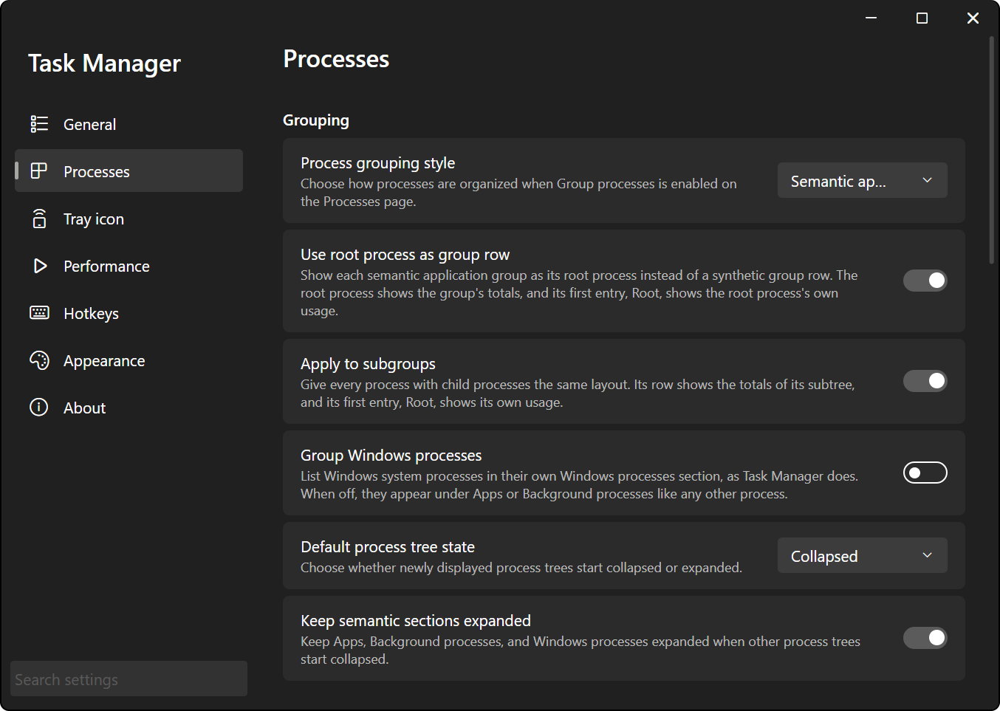

# Processes

The combined processes + details view. Windows Task Manager splits this across its Processes and Details pages; here it's one table with every Details column available, plus grouping, zoom and stretch, live column totals, multi-select and a search that understands expressions.

The table refreshes about once a second, but only while the Processes page is showing and the window is visible and not minimized. Switch pages or hide the window and sampling stops.

## Page Header

From left to right:

- **Group processes**: the toggle that switches between a flat list and a grouped tree, see [Grouping](#grouping). On by default.
- **Run new task**: opens a small panel under the header, see [Run New Task](#run-new-task).
- **Columns..**: opens the column chooser, see [Choosing and Ordering Columns](#choosing-and-ordering-columns).
- **End task**: ends the selected processes after a confirmation. Disabled with nothing selected, and reads **End tasks** when the selection covers more than one process.
- **Restart explorer**: restarts Windows Explorer, see [Restart Explorer](#restart-explorer).
- **More** (the **...** button): **Arrange buttons**, and the elevated termination entry described in [Administrator Rights](#administrator-rights).

### Arranging the Buttons

**More** > **Arrange buttons** lets you reorder the four middle buttons (**Run new task**, **Columns**, **End task**, **Restart explorer**). Drag the rows, or use the up/down arrows. The top item is the leftmost button. **Group processes** always stays on the left and **More** always stays on the right.

You can't hide any of them, only reorder them. Changes apply as you make them, so **Cancel** doesn't undo anything; it just closes the dialog like **Done** does. **Reset** goes back to the default order without asking.

### Run New Task

Type a program, a document, a folder, or a URI in the box, with arguments if it takes them, and press ++enter++ or **Run**. ++esc++ or **Cancel** hides the panel.

- The text is read the way the Windows **Run** dialog reads it, so `notepad C:\file.txt` opens the file in Notepad.
- The program starts the way Windows Task Manager's **Create new task** starts one with its administrator box off: as you, never with Task Manager's administrator rights, and not as a child of Task Manager. Explorer takes no part, so it also works while Explorer isn't running.
- There's no "run as administrator" option.
- If Windows can't take the command at all, you get a **Run new task failed** message and the panel stays open with your text in it. If Windows takes it but can't find what you typed, it shows the same message the **Run** dialog shows, and the panel has already closed.

### Restart Explorer

Ends every `explorer.exe` running in your session (the desktop, the taskbar, and all open File Explorer windows), then starts a fresh one the same way **Run new task** starts a program. By default it asks first (**Restart Windows Explorer?**). Turn on **Skip Explorer restart confirmation** in **Settings** > **Processes** > **Actions** to restart immediately.

The button stays disabled until the restart is done. If Explorer isn't running at all, for example after it crashed, it just starts a fresh one.

## Grouping

With **Group processes** off you get a plain flat list. With it on, the table uses the style picked in **Settings** > **Processes** > **Grouping** > **Process grouping style**:

- **Semantic application** (the default): processes are grouped into applications and listed in sections, like the Windows 11 Task Manager Processes page.
- **Parent process**: a classic process tree. Every process sits under the process that started it. A child is only nested under its parent when the parent is older than the child, so a reused PID doesn't produce a bogus tree. Parent rows show only their own numbers, nothing is added up.



### Sections

In **Semantic application** mode the groups are listed under section headings, always in this order:

- **Apps**: any group with a visible, titled, top-level window. This includes Windows' own processes, so Explorer shows up here while a File Explorer window is open.
- **Background processes**: everything else.
- **Windows processes**: only with **Group Windows processes** on (off by default). Groups led by a Windows system process (`svchost.exe`, `csrss.exe`, `dwm.exe`, `lsass.exe`, the System and Registry pseudo processes, Explorer without a window, etc.) get their own section, as in Windows Task Manager. With it off, they're listed under **Background processes**.

Each heading shows a count, e.g. **Apps (14)**. The count is the number of entries in the section, and it doesn't change while a search hides some of them. A section with nothing in it isn't shown. Section headings can't be selected or right-clicked.

### Group Rows and Root

A group with a single process is just that process's row. For bigger groups, it depends on **Use root process as group row** (on by default):

- **On**: the group's top process is the group row. Its row shows the totals for the whole group, and its first child is an entry named **Root** that shows the root process's own usage. **Root** always stays first, whatever the sort.
- **Off**: the group gets a separate group row named after the app (from the file description, or the process name) with the member count in brackets. Its PID cell is blank.

**Apply to subgroups** (on by default, only available with the option above on) does the same for every process inside a group that has its own children: its row shows the totals of its subtree, and its **Root** entry shows its own usage.

How the group totals are built:

- CPU, Disk, Network, GPU and NPU usage, memory, handles, threads, objects, page faults and I/O counters are added up.
- **Lifetime** shows the longest-lived member.
- **Status** on a synthetic group row shows the most urgent status of any member. On a root-process group row it's blank, and the **Root** entry carries the process's own status.
- Everything else (PID, user name, command line, etc.) comes from the process that leads the group.

What a group row acts on matters when you end things: selecting a group row and ending it ends every process in the group (or in the subtree). Selecting the **Root** entry acts on the root process only.

### Expanding and Collapsing

Click anywhere in the **Name** cell of an expandable row, not only the chevron.

- Clicking a collapsed row expands one level.
- Clicking an expanded row collapses it and everything under it.
- ++alt++ + click expands the whole subtree.
- On a section heading, collapsing collapses the section and every tree in it, and ++alt++ + click expands them all.

New trees start the way **Default process tree state** says (**Collapsed** by default). With **Keep semantic sections expanded** on (the default), the sections themselves stay open even when trees start collapsed. A tree's state is forgotten once its process exits.

While you're searching, every tree is expanded, and each change to the search text expands everything again. Clearing the search puts your earlier expand/collapse state back.

## Sorting

Click a column header to sort by it, click it again to reverse. Number columns sort highest first on the first click, text columns A to Z. There's no unsorted state. A small chevron at the right of the header shows the sorted column.

- The default sort is **Name**, A to Z. The sort isn't saved, so it's back to **Name** after the app restarts.
- Rows re-sort on every refresh.
- In grouped modes, each set of siblings is sorted on its own. Sections keep their fixed order and **Root** entries stay first.
- Ties are broken by PID.
- Unavailable values sort lowest.
- If you hide the sorted column, the sort moves to the first visible column.

## Selecting Processes

| Input | Result |
| --- | --- |
| Click | Selects only that row |
| ++ctrl++ + click | Adds or removes that row |
| ++shift++ + click | Selects the range from the last clicked row to this one |
| ++ctrl+shift++ + click | Adds that range to the selection |
| Click empty space in the table | Clears the selection |
| Click anywhere else in the window | Clears the selection, except on **End task** |

The selection follows the process, not the row position: it survives refreshes and re-sorting, and a process drops out of it when it exits. Collapsing a tree deselects the rows it hides.

There's no row navigation by keyboard on this page. The table's only keys are ++delete++ (end task) and ++esc++ (cancel a column drag).

## Row Menu

Right-click a row to open its menu. If the row isn't selected yet, it becomes the only selection first. If it's already selected, the menu acts on the whole selection. Labels switch to plural (**End tasks**, **Set priorities**, etc.) when the selection covers more than one process, which also happens with a single group row.

| Entry | When it's there | What it does |
| --- | --- | --- |
| **Copy** | Always | Copies the value of the column you right-clicked, one line per selected row |
| **Copy row** / **Copy rows** | Always | Copies every visible column of the selected rows as comma-separated values, one line per row, no header line |
| **End task** / **End tasks** | Always | Ends the processes after a confirmation |
| **End task tree** / **End task trees** | Always | Ends the processes and all their descendants after a confirmation |
| **Set priority** / **Set priorities** | Always | Submenu: **Realtime**, **High**, **Above normal**, **Normal**, **Below normal**, **Low**. Each level asks first |
| **Set affinity** / **Set affinities** | Always | Opens the processor affinity window |
| **Create memory dump file** | One process selected | Writes a full memory dump |
| **Open file location** | One process selected | Opens the executable's folder in Explorer with the file selected |
| **Properties** | One process selected | Opens the Windows file properties of the executable |
| **Switch to**, **Bring to front**, **Minimize**, **Maximize** | One process with a visible window | Acts on the process's main window |

Hovering **Copy** or **Copy rows** underlines the text that's about to be copied. Copied values are the text as displayed.

### End Task and End Process Tree

**End task** (menu entry, header button, or ++delete++) always asks first: **Do you want to end** *name*? for one process, or **Do you want to end** *N* **selected processes?** for several. There's no setting to skip this. ++delete++ and the menu entry keep the selection afterwards; the header button clears it.

Ending is immediate and forced. The program doesn't get a chance to save anything.

**End task tree** asks too: **Do you want to end the task tree of** *name*? for one process, or **Do you want to end the task trees of** *N* **selected tasks?** for several, with the same unsaved-data and system-instability warning. Confirm with **End task tree** (**End task trees** for several). It then finds every descendant of each selected process, ends them deepest first, then ends the selected processes themselves. Task Manager never ends itself, and critical Windows processes are skipped and reported.

**Cancel** (or ++esc++) on either prompt ends nothing.

If Windows refuses to end something because it's elevated, and elevated termination isn't on yet, you get the **Administrator approval required** prompt and then UAC, see [Administrator Rights](#administrator-rights). Approve and only the processes that were refused get ended again. With **End task tree** that can be a single elevated child, which is retried on its own even though its parent already ended. A child that still can't be ended shows up in the error as **Child process PID** *n*. Everything else was already handled on the first pass.

### Priority and Affinity

The priority submenu opens on hover. With one process selected, its current priority has a check mark. **Low** is what Windows calls the Idle class. Every level asks first, **Realtime** included: **Do you want to change the priority of** *name*? (or *N* **selected processes**), with the warning that changing the priority of certain processes could cause system instability. **Change priority** (**Change priorities** for several) applies it, **Cancel** leaves it alone.

The affinity window (**Processor affinity - PID** *n*) has a check box per logical processor (**CPU 0**, **CPU 1**, etc.), plus **Select all**, **Clear**, **Cancel** and **Apply**. With several processes selected, a box that differs between them shows a mixed state, and leaving it mixed keeps each process's own setting for that CPU. Every process needs at least one CPU checked, otherwise **Apply** refuses.

A UAC shield in front of **Set priority** and **Set affinity** means at least one of the selected processes needs administrator rights to change. See [Administrator Rights](#administrator-rights).

### Memory Dumps

**Create memory dump file** writes a full memory dump to:

```text
%TEMP%\TaskManagerTrayAppDotNET\<name>-<PID>-<yyyyMMdd-HHmmss>.dmp
```

There's no progress indicator. When it's done, a **Memory dump created** message shows the full path.

## Administrator Rights

TADN's Task Manager normally runs as a regular user, so some actions on elevated or protected processes need administrator approval. There are two separate mechanisms, and the difference matters.

**Priority, affinity and memory dumps** ask on their own. The first time Windows refuses one of those, you get an **Administrator approval required** prompt, then the Windows UAC prompt. Approve it once and the elevated helper stays until the app exits. Decline and nothing changes; you'll be asked again next time.

**End task** and **End task tree** use a separate elevated termination helper, but they ask on demand the same way. When Windows refuses to end a process for lack of rights and elevated termination isn't on, you get **Administrator approval required**, then UAC. Approve and the refused processes (and only those) are ended again, now with administrator rights. Elevated termination then stays on until the app exits, so later ends don't prompt. Decline either prompt and the refused processes are left alone without an error message (other failures in the same selection still get reported); the next refused end asks again. Critical Windows processes never trigger the prompt, since nothing ends them anyway. Neither does a process the app can't even check for being critical (some of Windows' own SYSTEM processes): ending it just fails with an access error, and if you really mean it, turn elevated termination on from the **More** menu first. A process Windows protects from administrators too still fails with an access error after you approve. If you started the app itself as administrator, there's nothing to approve and you won't be asked.

**Restart explorer** never asks for administrator approval.

You can also turn elevated termination on ahead of time:

- **More** > **Enable elevated termination...** asks **Enable elevated process termination?**, then shows the UAC prompt.
- Or turn on **Always run as administrator** in **Settings** > **General** > **Administrator actions**: the app then starts as administrator, so ending elevated processes never asks. See [Always Run as Administrator](index.md#always-run-as-administrator).

The **More** menu entry tells you where things stand: **Enable elevated termination...**, **Retry elevated termination...** (after you declined the UAC prompt), **Waiting for Windows approval**, or **Elevated termination enabled**.

## Status Column

Status shows the same three states the Windows 11 Task Manager shows. A process in none of them has an empty cell.

| Status | Glyph color | Meaning |
| --- | --- | --- |
| **Suspended** | Yellow | Every thread of the process is suspended. This covers processes suspended by a debugger or a tool, and packaged (Store) apps that Windows froze in the background. |
| **Efficiency mode** | Green | Windows' Efficiency mode: the process is power throttled (EcoQoS) and its priority is Low. That's exactly what Windows Task Manager's own Efficiency mode command sets, and what Chromium browsers do to their background processes. Power throttling alone doesn't count. |
| **Not responding** | Red | One of the process's top-level windows hasn't processed messages for five seconds. |

When more than one applies, **Not responding** wins over **Efficiency mode**, which wins over **Suspended**. A suspended process is never reported as **Not responding**.

By default the column shows glyphs; hover one to see its name. Right-click the **Status** header to switch **Status display** to **Text**, or to turn off **Center glyphs**. Copying, searching and sorting always use the text, so `{Status}="Suspended"` works in glyph mode too.

The **Power throttling** column reports the same thing as Efficiency mode: **Enabled** only for processes in Efficiency mode.

## Columns

There are 61 columns. These are visible by default: **Name**, **Status**, **PID**, **Disk**, **Network**, **CPU**, **CPU (single)**, **RAM (private)**, **RAM (shared)**, **GDI** and **Command line**. The last three are nicknames; see [Column Properties](#column-properties).

A column's data is only collected while the column is visible or used by the search. So adding columns costs a bit of CPU, and a newly shown column takes one refresh before it fills in. Rate columns like **Disk** and **CPU (single)** show 0 for their first interval.

Unavailable values show **N/A**.

### Choosing and Ordering Columns

**Columns..** opens **Select Processes columns**. The list holds every column, visible or not, in its left-to-right order.

- Click a row or its check box to show or hide that column. You can't hide the last visible one.
- Drag rows, or use the up/down arrows, to change the order. The table previews the new order live.
- **Search columns** filters the list by column name or nickname. It's forgiving: `pws` finds **Memory (private working set)**.
- **Hide unused columns** limits the list to the visible columns. Handy for reordering once you've picked your set.
- Changes apply as you make them. **Cancel**, **Done** and ++esc++ all just close the window.
- **Reset** asks **Reset process columns?** and then restores the default visibility, order, widths, nicknames and display options of every column.

### Resizing and Moving Columns

- Drag a divider in the header to resize the column to its left. The minimum width is 40.
- Drag a header cell to move the column. A line shows where it'll land.
- ++esc++ cancels a resize or move in progress.

With **Live column resizing** on (the default), the table reflows as you drag. Turn it off in **Settings** > **Processes** > **Columns and search** to drag a guide line instead and apply the width when you let go.

Column widths and order are saved.

### Column Properties

Right-click a column header to open its properties. Each column gets its own small window, you can keep several open, and every change applies immediately. Close it with the close button or ++esc++.

| Option | Columns | What it does | Default |
| --- | --- | --- | --- |
| **Column nickname** | All | Replaces the header text. Blank uses the original name. Nicknames also work in search. | Blank, except **RAM (private)**, **RAM (shared)** and **GDI** |
| **Show live total** | Columns that can be totaled | See [Live Totals](#live-totals) | Off |
| **Show % suffix** | **CPU**, **CPU (single)**, **CPU utility** | Shows `12.3%` instead of `12.3` | On |
| **Show decimal usage** | Same | Shows `12.3%` instead of `12%` | On |
| **Memory unit** | Memory columns | **Kilobytes**, **Megabytes**, **Gigabytes**, or **Percentage of system memory** | **Kilobytes** (**Megabytes** for **Memory (private working set)**) |
| **Memory suffix** | Memory columns | The unit text after the value. Picking a unit resets it, and blank means the unit's default. | `K`, `MB`, `GB`, `%` |
| **Status display** | **Status** | **Glyphs** or **Text** | **Glyphs** |
| **Center glyphs** | **Status** | Centers the glyph instead of right-aligning it. Only in glyph mode. | On |
| **Show account prefix** | **User name** | Shows `DOMAIN\user` instead of `user`. Sorting follows what's shown. | Off |

The percent options don't exist for **GPU** and **NPU**.

### Resource Columns

A few columns are worth explaining:

- **CPU** is the process's share of all logical processors together, like in Windows Task Manager.
- **CPU (single)** is how busy the process's busiest thread was, out of one processor, so 0 to 100 %. Use it to spot single-thread bottlenecks. On a 24-thread CPU, a process with one thread pegged shows about 4.2 % **CPU** but 100 % **CPU (single)**.
- **CPU utility** is CPU cycles used compared with the nominal cycle capacity of the active processors. Unlike **CPU**, it can read above 100 %.
- **Disk** only counts actual file reads and writes by the process, in MB/s (1 MB = 1,048,576 bytes). Pipe and device I/O isn't included; that's in the **I/O** columns.
- **Network** is the process's own traffic in Mbps (megabits). It updates when Windows reports, not every second, and it reads **N/A** until the first report comes in. Unless you started the app itself as administrator, only your own processes get numbers; services and other users' processes show 0.
- **RAM (private)** is **Memory (private working set)**: memory only this process uses. **RAM (shared)** is the rest of its working set.
- **GPU** and **NPU** show the busiest engine's utilization. **GPU engine** and **NPU engine** say which engine that is, e.g. `GPU 0 - 3D`.

??? note "All columns"

    | Column | Shown by default | Live total | What it shows |
    | --- | --- | --- | --- |
    | **Name** | Yes | | Process name |
    | **PID** | Yes | | Process ID |
    | **Status** | Yes | | See [Status Column](#status-column) |
    | **User name** | | | The account the process runs as |
    | **Session ID** | | | Windows session number |
    | **Job object ID** | | | Job object the process belongs to, blank if none |
    | **CPU** | Yes | Yes | Share of all logical processors |
    | **CPU (single)** | Yes | Yes | Busiest thread's share of one processor |
    | **CPU time** | | Yes | Total CPU time used, `H:MM:SS` |
    | **Lifetime** | | | Time since the process started, `16:12:01` or `1d 8:10:22` |
    | **Cycle** | | Yes | Total CPU cycles used |
    | **Working set (memory)** | | Yes | Working set |
    | **Peak working set (memory)** | | Yes | Highest working set so far |
    | **Working set delta (memory)** | | Yes | Change in working set since the last refresh |
    | **Memory (active private working set)** | | Yes | Currently the same value as **Memory (private working set)** |
    | **Memory (private working set)** | Yes, as **RAM (private)** | Yes | Memory only this process uses |
    | **Memory (shared working set)** | Yes, as **RAM (shared)** | Yes | Working set minus the private part |
    | **Disk** | Yes | Yes | File reads and writes, MB/s |
    | **Network** | Yes | Yes | Network traffic, Mbps |
    | **Commit size** | | Yes | Committed memory |
    | **Paged pool** | | Yes | Paged kernel pool |
    | **NP pool** | | Yes | Non-paged kernel pool |
    | **Page faults** | | Yes | Total page faults |
    | **PF Delta** | | Yes | Page faults since the last refresh |
    | **Base priority** | | | Base priority number |
    | **Handles** | | Yes | Open handles |
    | **Threads** | | Yes | Threads |
    | **User objects** | | Yes | USER objects (0 if the process can't be opened) |
    | **GDI objects** | Yes, as **GDI** | Yes | GDI objects (0 if the process can't be opened) |
    | **I/O reads**, **I/O writes**, **I/O other** | | Yes | I/O operation counts |
    | **I/O read bytes**, **I/O write bytes**, **I/O other bytes** | | Yes | I/O byte counts, as plain numbers |
    | **Image path name** | | | Full path of the executable |
    | **Command line** | Yes | | Full command line |
    | **Operating system context** | | | Always `Windows` |
    | **Platform** | | | `32-bit` or `64-bit` |
    | **Elevated** | | | `Yes` or `No` |
    | **UAC virtualization** | | | `Not allowed`, `Enabled` or `Disabled` |
    | **Description** | | | File description of the executable |
    | **Data execution prevention** | | | `Enabled` or `Disabled` |
    | **I/O priority** | | | `Very low` to `Critical` |
    | **Package name** | | | Package full name, for packaged apps |
    | **Enterprise context** | | | Windows Information Protection context |
    | **Power throttling** | | | `Enabled` while in Efficiency mode, otherwise `Disabled` |
    | **GPU** | | Yes | Busiest GPU engine's utilization |
    | **GPU engine** | | | Which GPU engine that is |
    | **Dedicated GPU memory** | | Yes | Dedicated GPU memory in use |
    | **Shared GPU memory** | | Yes | Shared GPU memory in use |
    | **DPI awareness** | | | `Unaware`, `System` or `Per-Monitor` |
    | **Architecture** | | | `x86`, `x64` or `ARM64` |
    | **Hardware-enforced Stack Protection** | | | `Enabled` or `Disabled` |
    | **Extended Control Flow Guard** | | | `Enabled` or `Disabled` |
    | **Isolation** | | | `UWP`, `AppContainer` or `None` |
    | **NPU**, **NPU engine**, **Dedicated NPU memory**, **Shared NPU memory** | | Yes, except **NPU engine** | Same as the GPU columns, for NPUs |
    | **CPU utility** | | Yes | Cycles used against nominal capacity |

## Live Totals

The "dynamic sum totals". Any column marked in the list above can show a live total in its header, e.g. `23.4% CPU`. Turn it on with **Show live total** in the column's properties (right-click the header).

- The total adds up every process. The search, grouping, collapsed trees and the selection don't change it.
- CPU totals leave out the System Idle Process.
- **CPU (single)** totals are a plain sum of each process's value, so they can go past 100 %.
- Totals use the column's own format (unit, suffix, decimals).
- While any visible column has its total on, every process is sampled on every refresh, not only the rows on screen. That costs a bit more CPU.

By default the total sits on the same line, in front of the column name. When the column is too narrow, the name gets cut first. The look is set in **Settings** > **Processes** > **Live totals**, see [Settings](#settings).

## Zoom and Stretch

Zoom changes the text size of the rows; stretch changes the space between them. Both apply to every table in Task Manager, not only Processes, and both are saved.

| Input | Action |
| --- | --- |
| ++ctrl++ + scroll wheel | Zoom in or out, 0.5 per notch (8 to 32) |
| ++shift++ + scroll wheel | Stretch, 1 per notch (0 to 32) |
| ++ctrl++ + middle-click, or ++ctrl+alt++ + scroll wheel | Reset zoom to the baseline |
| ++shift++ + middle-click, or ++shift+alt++ + scroll wheel | Reset stretch to the baseline |
| ++ctrl+alt++ + middle-click | Make the current zoom the baseline |
| ++shift+alt++ + middle-click | Make the current stretch the baseline |

The baseline is what "reset" goes back to. By default that's a zoom of 12 and a stretch of 3.5.

**Note**: over the table, ++shift++ + scroll wheel stretches instead of scrolling sideways. Use the scroll bar to scroll horizontally.

Zoom only affects the rows. The column headers keep their size.

## Search

The search box sits at the top of the window. Plain text searches names and PIDs; anything with `{`, `&&` or `||` in it is treated as an expression. It filters as you type.

In grouped modes, every match brings its parent chain with it, so you can see where it lives. Children of a match only show if they match too. Sections without a match disappear.

### Plain Search

Plain text matches any process whose **Name** or **PID** contains it, ignoring case. `chrome` finds `chrome.exe`, `4242` finds every PID containing those digits. Regex characters are just characters here.

### Expressions

Write `{Column} operator value`, and combine those with `&&`, `||` and parentheses.

| Syntax | Meaning |
| --- | --- |
| `=`, `!=` | Equal, not equal (whole value, ignoring case) |
| `<`, `<=`, `>`, `>=` | Greater or less than. Numeric on number columns, alphabetical on text columns |
| `=~`, `!~` | Matches, or doesn't match, a regular expression (.NET, case-insensitive) |
| `&&`, `\|\|` | And, or. `&&` binds tighter than `\|\|` |
| `( ... )` | Grouping |

```text
{Lifetime}>=1h&&{Lifetime}<2h
{Status}=""&&{CPU}>10%
{Command line}=~"--type=(renderer|gpu-process)"
chrome&&({Status}="Efficiency mode"||{Status}=Suspended)
{RAM (private)}>1g
{Network}>10Mbps
```

- Spaces around operators are optional.
- Column names are the full titles (**Command line**, **CPU (single)**), ignoring case. Nicknames work too, so `{RAM (private)}` is fine.
- A bare word inside an expression, like `chrome` above, is the same Name/PID search as plain text.
- Values can be quoted with `"` or `'`. Quote anything that contains `)`, `&&` or `||`. That means regex groups always need quotes, because an unquoted `)` ends the value.
- Inside quotes, `\"` is a literal quote. Other backslashes are passed through, so `\d` and `\.` reach the regex as you typed them.
- `=` on text is a whole-value match. Use `=~` for "contains".
- Regex runs against the text you see in the cell, even on number columns.
- **Status** compares against its text: `Suspended`, `Efficiency mode`, `Not responding`, or empty.
- An expression can hold up to 256 comparisons.

***An invalid expression doesn't show an error. The table just goes empty.*** If you're staring at no results, check your braces, quotes and operator first. `==` isn't an operator, for example.

### Values and Units

Number comparisons use the real value, not the rounded number on screen. That's why `=` rarely matches something like CPU or memory; use ranges.

| Columns | What you can type |
| --- | --- |
| **CPU time**, **Lifetime** | A number with `ms`, `s`, `m` or `min`, `h`, or `d` (e.g. `90s`, `1.5h`), or the displayed form `1:30:00` / `1d 2:00:00`. No combined units like `1h30m`. |
| **CPU**, **CPU (single)**, **CPU utility**, **GPU**, **NPU** | A number with an optional `%` |
| Memory columns and the I/O byte columns | A number with `b`, `k`, `m`, `g` or `t` (`kb`, `kib`, etc. also work), in steps of 1024. Doesn't depend on the unit the column displays. |
| **Disk** | Same units as memory, optionally followed by `/s` or `ps` |
| **Network** | A number with `k`, `m`, `g`, ... in steps of 1000, in bits per second, optionally followed by `/s` or `ps`. `10m`, `10Mb` and `10Mbps` all mean 10 megabits per second. Careful: `MB` means megabits here too. |
| Other number columns | A plain number, optionally with `k`, `m`, ... in steps of 1000 |

Use `.` as the decimal point. Unavailable values never match a number comparison, not even `!=`. On number columns, `=` and `!=` with something that isn't a number compare the displayed text instead, so `{Lifetime}=N/A` works.

**Note**: a bare number on **CPU time** or **Lifetime** is read in 100-nanosecond units. Always give a unit.

### Searching Hidden Columns

Any column can be searched, visible or not. The search tells the sampler to collect the columns it uses, so `{CPU (single)}>=90%` works with that column hidden. If a searched column changes over time (CPU, memory, Status, Lifetime, etc.), every process is sampled on each refresh while the search is active.

### Autocomplete

Type `{` and a list of matching columns pops up (up to 8). Keep typing to narrow it down; it matches names, nicknames, prefixes and acronyms. Pick one with ++up++ / ++down++ and ++enter++ or ++tab++, or click it. ++esc++ closes the list. Moving the caret back inside existing braces opens it again.

### Saved Searches

When the box has text, two buttons appear to its left: **Clear search** (X) and **Save search**.

- **Save search** adds the current search to your saved list as **Saved Search 1**, **Saved Search 2**, etc. It's dimmed when that exact search is already saved.
- Click into the empty search box (or press **Clear search**) to open the saved list. Click an entry to run it.
- Hover an entry to get its rename button (left) and delete button (right). Rename edits the name in place: ++enter++ saves, ++esc++ cancels.
- Deleting is immediate, except for searches that use a regex (`=~` or `!~`), which ask **Delete saved search?** first. Those are the annoying ones to type again.
- ++esc++ in the search box closes the popup. It doesn't clear the text.

Saved searches are stored in `settings.xml` under `ProcessSavedSearches`, so they survive restarts and travel with the settings file. See [Configuration](../../getting-started/configuration.md). The current search text itself isn't saved.

## Settings

All of these are in **Settings** > **Processes**.

### Grouping

| Setting | Default | What it does |
| --- | --- | --- |
| **Process grouping style** | **Semantic application** | **Semantic application** or **Parent process**. Used while **Group processes** is on. |
| **Use root process as group row** | On | Semantic only. See [Group Rows and Root](#group-rows-and-root). |
| **Apply to subgroups** | On | Semantic, with the option above on. |
| **Group Windows processes** | Off | Semantic only. Adds the **Windows processes** section. |
| **Default process tree state** | **Collapsed** | Whether new trees start **Collapsed** or **Expanded**. |
| **Keep semantic sections expanded** | On | Only shown with **Collapsed**. Keeps the sections open anyway. |

### Zoom and Stretch

| Setting | Default | Range |
| --- | --- | --- |
| **Zoom** | 12 | 8 to 32 |
| **Baseline zoom** | 12 | 8 to 32 |
| **Stretch** | 3.5 | 0 to 32 |
| **Baseline stretch** | 3.5 | 0 to 32 |
| **Font weight** | **Normal** | **Thin** to **Black**, for the rows and column headers |

The number cards have a **Reset** button. **Zoom** and **Stretch** reset to their baselines; the baselines reset to 12 and 3.5.

### Live Totals

| Setting | Default | What it does |
| --- | --- | --- |
| **Show totals above column names** | Off | Puts totals on their own line above the names. The header row doubles in height while any total is visible. |
| **Total font size** | 13 | 6 to 24 |
| **Total font weight** | **Normal** | |
| **Total width** | 75 % | Squishes totals horizontally (25 to 100 %) so wide values fit. 100 % draws them unscaled. |
| **Gap before column name** | 4 | Space between a total and its column name on the same line (0 to 32) |

### Columns and Search

| Setting | Default | What it does |
| --- | --- | --- |
| **Live column resizing** | On | Reflow the table while dragging a divider. Off shows a guide line and applies on release. |
| **Left-align search bar** | Off | Puts the search box at the left edge of the page area instead of centered in the window. This applies to the search box on every page. |

### Actions

| Setting | Default | What it does |
| --- | --- | --- |
| **Skip Explorer restart confirmation** | Off | **Restart explorer** restarts right away without asking. |

## Key Bindings

These are listed (read-only) in **Settings** > **Hotkeys** > **Tables**. They can't be rebound.

| Where | Input | Action |
| --- | --- | --- |
| Any table | ++ctrl++ + scroll wheel | Zoom |
| Any table | ++shift++ + scroll wheel | Stretch |
| Any table | ++ctrl++ + middle-click, or ++ctrl+alt++ + scroll wheel | Reset zoom |
| Any table | ++shift++ + middle-click, or ++shift+alt++ + scroll wheel | Reset stretch |
| Any table | ++ctrl+alt++ + middle-click | Set baseline zoom |
| Any table | ++shift+alt++ + middle-click | Set baseline stretch |
| Process table | ++delete++ | End task (with confirmation) |
| Process table | ++esc++ | Cancel a column resize or move |
| Process table | ++alt++ + click on a **Name** cell | Expand the whole tree |
| Process table | ++ctrl++ / ++shift++ / ++ctrl+shift++ + click | Multi-select, see [Selecting Processes](#selecting-processes) |
| Process table | Right-click a header | Column properties |
| Search box | ++up++ / ++down++, ++enter++ or ++tab++, ++esc++ | Navigate, accept, close autocomplete |
| Run new task box | ++enter++ / ++esc++ | Run / hide the panel |

The other pages' tables have their own row keys, see [Other Pages](other-pages.md). Window-level bindings are on [Task Manager](index.md).

## Usage Notes

- Live totals ignore the search, so they always show the whole system, never just the matches.
- Section counts don't shrink while you search.
- Selected rows that a search hides stay selected, and **End task** still includes them. Check the button label (**End task** vs **End tasks**) before you press ++delete++.
- **Copy rows** on a collapsed group row copies that one row with the group's totals, not the member rows.
- **Memory (active private working set)** currently shows the same number as **Memory (private working set)**.
- Enabling elevated termination doesn't change the Network column. Only starting the app itself as administrator gets you network numbers for services and other users' processes.
- The Performance page is documented on [Performance](performance.md).
