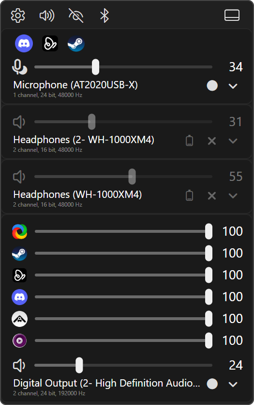

# Volume

A volume mixer and audio endpoint manager. EarTrumpet users will find this familiar; I took inspiration from it in this design. Originally, I'd modified EarTrumpet to sort its mixer bottom-up like this, to minimize mouse movement distance. Since that project seems to have been abandoned, I took a crack at the whole thing.

Every setting mentioned here is listed with its default in [Volume Settings](settings.md).

## Flyout

Left-click the tray icon and the flyout opens above it. Left-click again to close it, press ++esc++, or click anywhere else (that last one only while it's docked).

The flyout is a stack of device cards. Each card is one audio device (Windows calls them endpoints): your speakers, headphones, HDMI outputs, microphones, etc. Each card has the device's volume slider at the bottom and that device's apps above it.

### Bottom-Up Order

The whole list is built bottom-up. The default playback device sits at the very bottom, right above the tray icon you just clicked, so the slider you want most is the one closest to your mouse. The flyout always opens scrolled to the bottom.

With **Device sort** on **Default**, devices are grouped from the bottom up: the default device, then the default communications device, then other enabled devices, then disabled devices, then disconnected devices at the top.

With **Intermix recording with playback** off (the default), all recording devices sit above all playback devices. Turn it on and recording devices mix in with playback devices inside each of those groups.

If you'd rather see devices in the same order Windows lists them, top to bottom, set **Device sort** to **Windows order**.

### Device Cards

A device card has two rows: the slider row and the title row.

The slider row:

- **Mute button** on the left. Speaker glyph for playback devices, microphone glyph for recording devices. Hover it and it previews what a click will do. Muted devices are drawn dimmed.
- **Volume slider** with the peak meter drawn on its track. Drag it, click the track, or use the scroll wheel over it. The wheel step is **Wheel volume step (%)**.
- **Percent** on the right. Double-click it and type a value, then ++enter++ to apply or ++esc++ to cancel. `45` and `45%` both work, anything outside 0 to 100 gets clamped.

The title row:

- **Device name**. Double-click it to rename the device, see [Renaming](#renaming). Right-click it to pick the device's sample rate, see [Sample Rate and Format](#sample-rate-and-format).
- **Format strip** under the name, e.g. `2 channel, 24 bit, 48000 Hz`. On Bluetooth devices it also shows connection progress and, optionally, the codec.
- **Row buttons** on the right, described in [Row Buttons](#row-buttons).

On recording devices the microphone glyph also tells you what's going on: a crossed-out mic when muted, a listening mic when **Listen to this device** is on, and a sleeping mic when no app is capturing from it.

By default playback devices use a fixed speaker glyph. Turn on **Use dynamic playback volume glyph for playback devices in flyout** if you want it to follow the volume level like the tray icon does.

You can flip the layout around with **Device layout** (apps above or below the device row) and **Device title row position** (name above or below the slider). **Title bar at the bottom** moves the flyout's button bar to the bottom edge.

### App Drawers

Above each device's slider is its app drawer: one row per app that has audio on that device. Each row is the app's icon, a slider, and the percent. Hover an icon to see the app name and PID.

- Click an app's icon to mute or unmute that app. Muted apps are drawn dimmed.
- App sliders work like device sliders: drag, click, scroll wheel, or double-click the percent to type a value. With **Use logarithmic volume scale** on, they follow a decibel curve and the percent is the slider position, see [Logarithmic Scale](#logarithmic-scale).
- The chevron on the device's title row collapses or expands the drawer. It's greyed out when the device has no apps. Each device remembers its own state; **Expand app drawers by default** only decides the starting state for devices you haven't touched yet.
- Past **Max apps before scrolling - full sliders** rows, the drawer scrolls.

Some stuff you won't see in there: **System Sounds**, and VolumeTrayAppDotNET's own beep. When Windows reports the same app on more than one device, it shows up only once: on the device where it's actually playing, or on the default device when it's playing nowhere.

Recording devices get an icon grid instead of sliders by default. Recording devices don't go through a volume mixing layer, so per-app sliders there are pointless. If you want the flyout to look consistent anyway, set **App drawer display type** to **Full sliders**. Recording app icons can't be muted from the flyout.

**Visually indicate actively capturing apps** decides how the recording drawers mark which apps have the microphone open right now:

- **Active glyph** (default): a small dot on the icon of each app that's capturing (a lock instead, when an app holds the device in exclusive mode). Only drawn in the icon grid.
- **Dim inactive**: apps that aren't capturing are dimmed.
- **Hide inactive**: apps that aren't capturing aren't shown at all.
- **Don't indicate**: nothing.

The grid's look (icon size, icons per row, stack direction, centering) is all on the **App drawers** settings page.

### Logarithmic Scale

Windows applies an app's volume as a straight multiplier on its audio signal. On a plain slider that means 50% is only 6 dB quieter than 100%, and everything below -14 dB gets squeezed into the bottom 20% of the slider.

**Use logarithmic volume scale** (**Settings** > **General**, off by default) puts the app sliders on a decibel curve instead. Every 10% of slider travel is 6 dB, i.e. roughly half or double the level, so a scroll wheel notch changes loudness by the same amount wherever the thumb is. The exception is the bottom 14% or so, which is a straight fade down to silence. 0 is still silence and 100 is still full volume.

With it on, the percent next to an app slider is the slider position, not the level Windows stores. ***The numbers won't match Windows' own volume mixer***, which shows the raw level: 90 here is 50 there, 80 is 25, 70 is 13, and 50 is 3.

Everything that touches an app slider goes through the same curve: dragging, clicking the track, the scroll wheel, typing a percent, and changes made in other mixers, which move the slider to the matching spot. The app's peak meter follows the curve too, so a full-scale signal still reaches the thumb. The volume change beep plays at the app's real level, so it still previews how loud the app will be.

Device sliders and tray icon scrolling don't change. Windows already puts device volume on its own curve, so the device percent keeps matching the Windows volume flyout.

Flipping the setting takes effect right away: app sliders jump to the spot that matches each app's current level. The levels themselves don't change.

### Peak Meters

The peak meter is the bar drawn over each slider track, i.e. the visual indicator of the current audio level. It never goes past the thumb: a full-scale signal fills the track up to the thumb. With **Use logarithmic volume scale** on, app meters read on the same decibel curve as the app slider, so quiet audio shows a longer bar than it would on a plain slider. It's smoothed: Windows gets sampled 90 times a second and the meter is redrawn 180 times a second, interpolating in between, so it glides instead of jumping. Both rates, and how far the meter can move in a single redraw, are under **Settings** > **Flyout** > **Peak meter**.

By default, **Unified peak meter** combines left and right into one bar. Turn it off and you get two layers instead: a solid bar up to the quieter channel, and a translucent overlay up to the louder one, so a stereo mismatch shows up as a halo past the solid bar. Both colors are in **Settings** > **Theme** > **Peak meter**.

Some recording devices only have a software peak meter, and it stays at zero until some app starts capturing. **Activate recording devices for peak meters** fixes that by opening a capture stream on every active recording device while the flyout is visible. It's off by default for a reason: while it's on, Windows shows VolumeTrayAppDotNET as using your microphones, and it can get in the way of apps that want exclusive access.

### Title Bar

From left to right:

- **Settings** (gear): opens the settings window.
- **Open Windows sound settings** (speaker): opens the classic Sound control panel on the Playback tab, or the Windows Settings sound page if you set **Sound settings button target** to **Windows Settings app**. If that window is already open, it gets brought to the front instead of opening a second one.
- **Show/hide disabled devices** (eye): flips **Show disabled devices** for both playback and recording in one click.
- **Bluetooth**: see [Bluetooth Button](#bluetooth-button).
- **Communications**: see [Communications Ducking](#communications-ducking).
- **Update**: only there when an update is available, see [Updates](../../getting-started/updates.md).
- **Undock** (far right): pops the flyout out into a free-floating window. Undocking works like in every TADN app, see [Tray Icon and Flyouts](../../shared/tray-and-flyouts.md).

### Communications Ducking

This is the classic Windows "When Windows detects communications activity" setting from the Communications tab of the Sound control panel, i.e. "Mute all other sounds", "Reduce the volume of other sounds by 80%", etc. The button is lit while ducking is on and dimmed when it's set to "Do nothing".

- Click: switches between **Mute all other sounds** and **Do nothing**.
- ++ctrl++ + click: **Reduce the volume of other sounds by 80%**.
- ++alt++ + click: **Reduce the volume of other sounds by 50%**.

**Note**: With **Communications ducking button** on its default, **When ducking is on**, the button hides itself as soon as ducking is set to "Do nothing". That includes when you turn it off with the button. If you want to switch ducking back and forth from the flyout, set it to **Always show**.

## Device Management

### Setting the Default Device

The circle button on each device's title row is the default-device button. Its glyph shows the device's state: a filled circle for the default device, a headset for the default communications device, and other glyphs for plain enabled and disabled devices. Disabled devices are also dimmed.

| Action | Result |
| --- | --- |
| Click | Make it the default device |
| ++shift++ + click | Make it the default communications device |
| ++ctrl++ + click | Enable or disable the device in Windows |
| Right-click | Open the device's own page in Windows Settings (format, enhancements, spatial sound, etc.) |

Clicking makes the device the default for everything except communications. Windows keeps a separate default for calls and voice chat. If you want both to always move together, turn on **Tie default comms device to default device**. That only applies to clicks in this app; if some other program changes your default, VolumeTrayAppDotNET leaves the communications default alone.

With **Device sort** on **Default** the list re-sorts after a default change, so the new default drops to the bottom. It waits until your mouse leaves the button though, so the list doesn't shift under your cursor mid-click.

**Note**: When you disable a device with ++ctrl++ + click and **Show disabled devices** is off, the device disappears from the flyout. Click the eye button in the title bar to bring disabled devices back into view, then ++ctrl++ + click it again to re-enable it. The default and default communications devices are the exception: by default they stay visible even while disabled.

### Renaming

Double-click a device's name, type the new one, and press ++enter++ (clicking elsewhere also saves). ++esc++ cancels. Clear the box and save to go back to the name Windows gave it.

For regular devices the new name is written into Windows itself, so it shows up in the Sound control panel and Windows Settings too. Bluetooth devices often refuse that, so their names are kept by VolumeTrayAppDotNET only, in `devices.xml` in its data folder (see [Configuration](../../getting-started/configuration.md)). Other apps keep showing the Windows name for those.

### Sample Rate and Format

Right-click a device's name or its format strip to get a list of the formats the device supports, e.g. `2 channel, 24 bit, 192000 Hz`. The current one is marked. Pick one and it becomes the device's default format in Windows, same as the dropdown in the Sound control panel's Advanced tab. Expect a short audio dropout on that device while Windows switches over.

When a device won't list its supported formats, you get the common sample rates from 8000 to 192000 Hz at the current channel count and bit depth instead.

The format strip under each device name is **Show default-format readout** in the flyout settings.

### Visibility

Which devices make it into the flyout and tray menu is on **Settings** > **Devices**, with separate switches for playback and recording:

- **Show recording devices**: master switch for recording devices. Off hides them everywhere and ignores every other recording switch.
- **Show disabled devices**: devices that are disabled in Windows.
- **Show default device even if disabled** and **Show default comms device even if disabled**: keep those two visible while disabled devices are hidden. These only show up while **Show disabled devices** is off.
- **Show disconnected devices**: devices Windows still knows about but that aren't plugged in right now.
- **Show registry ghost devices**: endpoints Windows still has on file but has no driver loaded for, i.e. that USB DAC from three years ago, the HDMI outputs of your old GPU, etc. Most of them just show up as "Unknown Device", which is why it's off by default.

**Show recording devices** on the **Flyout** page is a second switch that only hides recording devices from the flyout. The Devices page switch still wins.

### Row Buttons

The title row of each device can hold a few more buttons. Each one has its own playback and recording switch under **Settings** > **Devices** > **Row buttons**. Only the default-device button and the Bluetooth battery indicator are on by default.

- **Show Bluetooth battery indicator**: see [Bluetooth](#bluetooth).
- **Show exclusive-mode (lock) button**: toggles the device's "Allow applications to take exclusive control of this device" checkbox. Dimmed means exclusive mode is not allowed. It shows a closed lock while an app is actually holding the device exclusively.
- **Show Equalizer APO button**: see [Equalizer APO](#equalizer-apo).
- **Show default-device button**: the button from [Setting the Default Device](#setting-the-default-device).
- **Show "Listen to this device" button** (recording only): toggles Windows' "Listen to this device", i.e. playing the microphone back through a playback device.
    - Click: turn it on or off. The playback target stays whatever it was.
    - ++ctrl++ + click: turn it on with **Default playback device** as the target.
    - Right-click: pick the target from a list of your active playback devices.

**Note**: Turning on Listen also turns that recording device's audio enhancements back on if they were disabled ("Disable all enhancements" unchecked). Windows routes the listen monitor through the enhancements pipeline, and with them disabled you'd hear nothing.

### Equalizer APO

If you use [Equalizer APO](https://sourceforge.net/projects/equalizerapo/), the EQ button installs it on or removes it from a device without going through its Configurator. The app looks for it in `C:\Program Files\EqualizerAPO`.

- Lit: Equalizer APO is running on this device. Click to remove it from the device.
- Dimmed: it's not installed on this device (click to install), or it's installed but the device's enhancements are disabled (click to enable).
- With a small badge: Equalizer APO isn't installed on this PC at all. Click it for a dialog with a download link.
- ++ctrl++ + click or right-click: open the Equalizer APO Configuration Editor.

Installing or removing restarts the device, so whatever is playing on it cuts out for a moment.

**Note**: Installing or removing Equalizer APO on a device writes to the machine-wide audio registry, which needs admin rights. Run VolumeTrayAppDotNET as administrator for this. Without that, the click does nothing.

## Bluetooth

### Bluetooth Devices in the Flyout

Paired Bluetooth headphones and speakers that aren't connected still get a card by default, so you can connect them from the flyout. The settings for this are on **Settings** > **Flyout**:

- **Disconnected Bluetooth audio devices**:
    - **Never show**: hide them.
    - **Show**: treat them like any other disconnected device, i.e. they follow **Show disconnected devices** and **Show registry ghost devices**.
    - **Always show**: always list them, as their own group above all the other devices (below them with **Windows order**).
    - **Always show (intermixed)** (default): always list them, sorted in with the rest.
- **Collapse disconnected Bluetooth devices** (on): one card per disconnected Bluetooth device instead of one per endpoint. A headset usually has a stereo playback endpoint, a hands-free playback endpoint, and a hands-free microphone, so without this you'd get three cards for one pair of headphones. Once any of its endpoints is connected, every endpoint gets its own card again.
- **Only show Bluetooth devices while Bluetooth is on** (on): hides every Bluetooth device while the Windows Bluetooth radio is off. This one beats the setting above.

Endpoints left behind by devices you've unpaired, or by older pairings of the same device, never show up.

### Connecting and Disconnecting

Bluetooth devices get a button in their title row: a battery glyph with the remaining charge, or a plain Bluetooth glyph when the device doesn't report one. Hover it for the exact percentage.

- Disconnected device: click to connect. This sends the same request as the **Connect** button in Windows Settings.
- Connected device: ++ctrl++ + click to disconnect. Like **Disconnect** in Windows Settings, this drops the whole device, not just the endpoint you clicked.

Disconnected devices keep showing their last known charge.

After you click connect, the button gets a countdown ring and the format strip shows **Connection Pending** with the seconds left. The ring shrinks smoothly, or once a second when **Animations** (**Settings** > **Theme**) is off, and pauses while the flyout is closed. Windows doesn't actually report how a connection attempt is going, so that 30 second window is my own estimate of how long an attempt takes. Click again while it's pending to retry. Once the Bluetooth link is up but Windows hasn't brought the audio endpoint up yet, the strip shows **Connected - audio waiting**; click to retry if it sits there.

### Bluetooth Button

The Bluetooth button in the title bar does two things:

- ++ctrl++ + click: turn the Windows Bluetooth radio on or off.
- Any other click: open the Bluetooth page of Windows quick settings.

The button is dimmed while the radio is off. Hover it to see the current state and which click does what.

The power gesture is ++ctrl++ + click by default so a stray click doesn't turn Bluetooth off and drop your headphones mid-call. You can change it to a plain click, ++alt++ + click, or ++shift++ + click with **Bluetooth power button click action**. If you make it a plain click, ++ctrl++ + click opens quick settings instead. **Show Bluetooth power button** hides the button entirely.

### Codec

**Show Bluetooth codec on the format strip** adds the codec in use (SBC, AAC, aptX, LDAC, etc.) to Bluetooth devices' format strip. Two catches:

- The app has to run as administrator. Otherwise the codec stays unknown.
- Windows only reports the codec when audio actually starts streaming to the device, not when it connects. A connected but idle headset shows no codec until something plays on it. There is no way to ask Windows for it on demand, and guessing it from sample rates and the like isn't accurate. That's a Windows Bluetooth limitation.

## Volume Change Sounds

VolumeTrayAppDotNET plays a short beep when you change a volume, so you can hear the new level:

- Playback devices: the beep plays through the device you just adjusted, not the default device. Recording devices stay silent.
- Apps: the beep plays at the level you set the app to, so quieter apps preview quieter. It plays through VolumeTrayAppDotNET's own audio, so if you've turned VolumeTrayAppDotNET itself down in some other mixer, the beep comes out quieter too.
- Tray icon scrolling: same as the playback device beep. It has its own switch, and needs the playback device beep on as well.

The beep waits until you stop dragging or scrolling, and **Skip the sound when audio is already playing** (on by default) drops it when something is already playing on that device or app, so it doesn't step on your music or call. The cutoff is **Peak meter threshold (%)**, default 5.

All of these are under **Settings** > **General** > **Volume changed ping**.

## Tray Icon

The tray icon shows the volume of the default playback device: a muted glyph, a silent glyph at 0%, and low, medium or high below 34%, below 67% and above that, with the full-volume glyph drawn faintly behind the lit part. Hover it for the device name and level, e.g. `Speakers: 42%` or `Speakers: muted`. With no playback device at all, it says **No audio device**.

| Action | Result |
| --- | --- |
| Left-click | Open or close the flyout |
| Double-click | Open the flyout (configurable) |
| Right-click | Tray menu |
| Scroll wheel | Default device volume up/down by **Wheel volume step (%)** (2) |
| ++ctrl++ + scroll wheel | Same, by **Wheel volume step (%) - fine** (1) |
| ++alt++ + scroll wheel | Same, by **Wheel volume step (%) - coarse** (5) |
| Touchpad two-finger scroll | Default device volume in 1% steps |
| ++enter++ / ++space++ on the focused icon | Open the flyout |
| ++shift+f10++ / ++menu++ on the focused icon | Tray menu |

There's no middle-click action.

Scrolling over the tray icon works without a global mouse hook. Nothing sits there watching every mouse movement on your system. After each scroll the tooltip pops up with the new level.

With a precision touchpad, two-finger scrolling over the icon moves the volume 1% at a time, regardless of the wheel step settings and of ++ctrl++ or ++alt++. **Touchpad sensitivity** is how much finger movement one 1% step takes (default 90 raw touchpad units, lower is more sensitive).

### Modified Actions

Under **Settings** > **Tray icon** > **Modified actions** you can change what each scroll and click does:

- **Mouse wheel**, **Ctrl + mouse wheel**, **Alt + mouse wheel**: **Nothing**, or one of the three wheel steps.
- **Ctrl + left-click**, **Alt + left-click**, **Ctrl + right-click**, **Alt + right-click**, **Double-click**, **Ctrl + double-click**, **Alt + double-click**: **Nothing** or **Open settings**.

A modified entry (the ones with Ctrl or Alt) set to **Nothing** falls back to the plain action. E.g. with **Ctrl + right-click** on **Nothing**, ++ctrl++ + right-click still opens the tray menu. A plain **Mouse wheel** set to **Nothing** turns plain scrolling off.

## Tray Menu

Right-click the tray icon:

- **Sound devices**: the classic Sound control panel, Playback tab.
- **Bluetooth**: the Bluetooth page of Windows quick settings.
- **Settings**
- **Exit**

You can add more entries under **Settings** > **Tray icon** > **Context menu**:

- **Show "Recording" link in tray menu**, **Show "Sounds" link in tray menu**, **Show "Communications" link in tray menu**: entries that open the Sound control panel straight on that tab.
- **Show per-device links in tray menu**: one entry per device the flyout lists, at the top of the menu, in the flyout's order flipped over, so the flyout's bottom device (the default device, with the default sort) comes first. The flyout's Bluetooth-only visibility settings don't apply here. Each entry opens that device's page in Windows Settings, same as right-clicking its default-device button in the flyout. **Playback device names**, **Recording device names**, and **Device name max length** control how those entries are labeled: **Name and model** is the full Windows name (e.g. "Speakers (Realtek(R) Audio)"), **Name** is just "Speakers", **Model** is just "Realtek(R) Audio". Names longer than the max length get cut off with `..`.

**Menu position** picks between **Modern** (default, docked above the taskbar like the Windows 11 system flyouts) and **Classic** (at the cursor). The menu's size follows **Settings** > **Theme** > **Font size**.

The rest of the tray menu customization is shared, see [Tray Icon and Flyouts](../../shared/tray-and-flyouts.md).

## Key Bindings

Global hotkeys, both unbound until you set them under **Settings** > **Hotkeys**. Rebinding works like in every TADN app, see [Hotkeys](../../shared/hotkeys.md).

| Action | What it does |
| --- | --- |
| **Open flyout** | Shows the flyout |
| **Open settings** | Opens the settings window |

In the flyout:

| Key | Where | Action |
| --- | --- | --- |
| ++esc++ | Flyout | Close the flyout |
| ++enter++ / ++space++ | Focused device name | Start renaming |
| ++enter++ / ++space++ | Focused percent | Start typing a value |
| ++enter++ | Rename or percent box | Save |
| ++esc++ | Rename or percent box | Cancel |
| ++up++ / ++down++ | Format or Listen menu | Previous / next entry (wraps around) |
| ++home++ / ++end++ | Format or Listen menu | First / last entry |
| ++esc++ | Format or Listen menu | Close the menu |

The format menu has no keyboard way in, it's right-click only.

## Usage Notes

- The settings window, themes, language, run on startup, installation and crash recovery are the shared stuff, see [Shared Features](../../shared/index.md).
- `settings.xml` holds the app settings. `devices.xml`, next to it, holds the per-device bits: each device's app drawer state and the custom names of Bluetooth devices. Exit the app and delete `devices.xml` to reset those. Where the folder is: [Configuration](../../getting-started/configuration.md).
