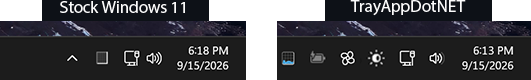

# TrayAppDotNET

A suite of Windows 11 apps focused around one of the most under-loved pieces of UX ever: the tray.

TrayAppDotNET (TADN for short) is my set of replacements for, and additions to, the Windows 11 tray system apps. Every app is its own tray icon, and you can install as many or as few of them as you like. For the best effect, I recommend removing the stock Windows tray icons with [Windhawk](https://windhawk.net/).

*This is an incomplete example. The stock tray icons were removed with [this Windhawk mod](https://windhawk.net/mods/taskbar-tray-system-icon-tweaks).*

**Project status**: These apps should all be considered alpha. They're exceptionally stable, but some apps still have large gaps that need to be filled in.

## The Apps

- [Battery](apps/battery/index.md): charge level, charge and discharge rate in watts, battery health, and time estimates that don't swing around every few seconds. Also has a power mode slider and an Energy Saver toggle. For laptops.
- [Brightness](apps/brightness/index.md): controls the *actual* brightness of external displays over DDC/CI, as well as Windows brightness (laptops) and Windows Night Light. Has a day/night curve that moves brightness with the sun.
- [Fan Control](apps/fan-control/index.md): a UX wrapper around LibreHardwareMonitor for watching sensors and setting fan speeds. Not to be confused with the popular "Fan Control" project.
- [Network](apps/network/index.md): as simple as it gets. Opens the still-embedded Win10 network flyout, with some quick-access stuff in its tray menu.
- [Task Manager](apps/task-manager/index.md): a "reimplementation" of the Windows 11 Task Manager. The official one got far too stuttery for me, and some extra bells and whistles got added along the way.
- [Volume](apps/volume/index.md): a volume mixer and audio endpoint manager. EarTrumpet users will find it familiar.

The stuff every app shares (settings search, themes, hotkeys, tray menus, flyout undocking, crash recovery) is documented once, under [Shared Features](shared/index.md).

## Getting Started

Grab the installer for whichever app(s) you'd like, or the bundled suite, from the [releases page](https://github.com/alchemyyy/TrayAppDotNET/releases). Then install it. Done. The apps run portable just as well. See [Installation](getting-started/installation.md) for the details.

Settings and logs live in `%LocalAppData%\TrayAppDotNET` by default. See [Configuration](getting-started/configuration.md).

## Help and Feedback

Bugs and feature requests go on [GitHub Issues](https://github.com/alchemyyy/TrayAppDotNET/issues). There's also a [Discord](https://discord.gg/nzg7jm8yKC).

The source is on [GitHub](https://github.com/alchemyyy/TrayAppDotNET), licensed under the GPL-3.0. The **Development Notes** tab has technical write-ups on how some of the internals work. You don't need any of it to use the apps.
