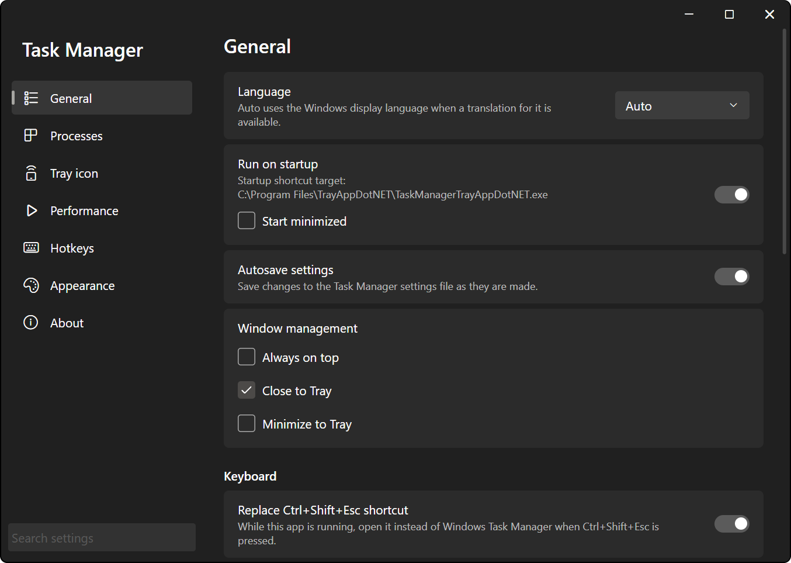
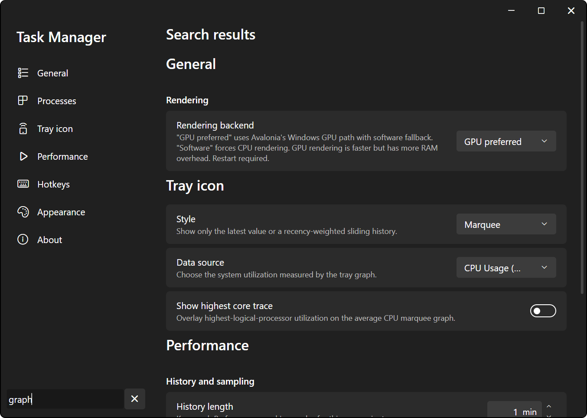
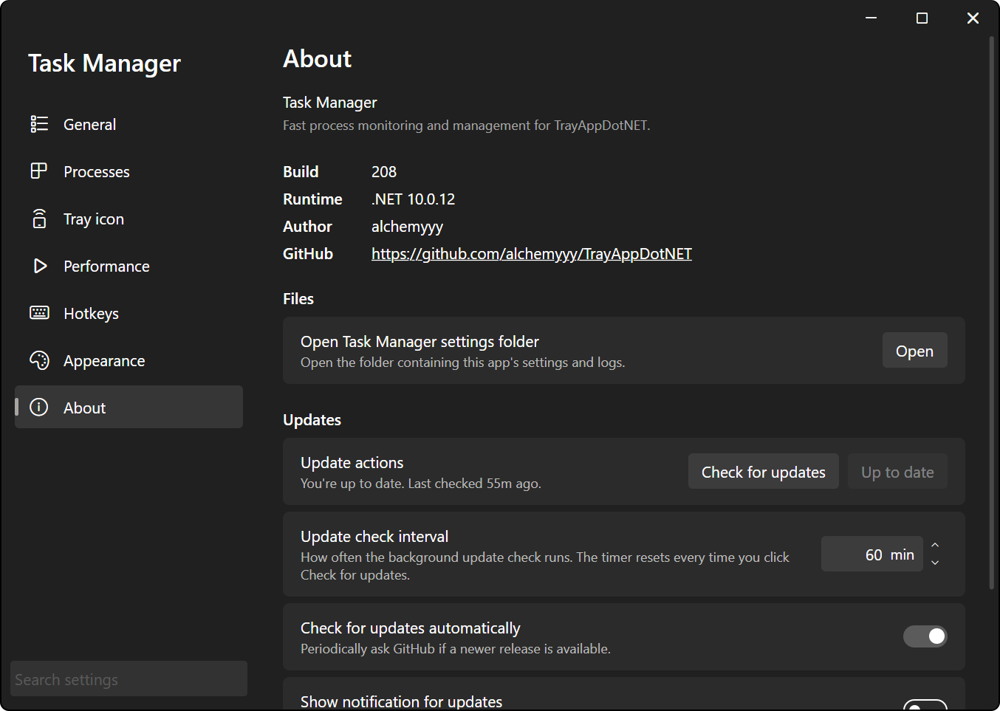

# Settings Window

Every TADN app uses the same settings window: a page list on the left, the current page on the right, and a search box that looks through every page at once. Changes take effect as you make them. There's no OK or Apply button.

## Opening Settings

- Right-click the tray icon and pick **Settings** (**App Settings** in Network).
- Click the settings button in the flyout (Battery, Brightness, Fan Control, Volume).
- Press the **Open settings** hotkey, if you've bound one. See [Hotkeys](hotkeys.md).
- Task Manager has no Settings entry in its tray menu. Use the **Settings** row at the bottom of the main window's sidebar.

Some apps also open settings from a tray icon double-click; the app pages say which. If the window is already open, it's brought to the front instead of opening a second one.

## Layout

The sidebar holds the app header (**Settings**, or **Task Manager** in Task Manager), the page list, and the **Search settings** box at the bottom. Every app has a **General**, **Hotkeys**, **Theme** (called **Appearance** in Task Manager), and **About** page, with the app's own pages in between.

*Task Manager's settings window, with the Windows 11-style page list turned on.*

- The window has its own title bar. Drag it to move the window, double-click it to maximize. The window is resizable.
- Clicking the page you're already on scrolls it back to the top.
- **Windows 11-style settings menu** on the Theme page adds page glyphs and a Windows 11 style layout to the page list. It's off by default, except in Task Manager where it's on. See [Themes](themes.md).

### Resizing the Page List

Hold ++ctrl++ and drag the right edge of the page list to make it wider or narrower. ++ctrl++ + right-click on that edge puts it back to the default width. The width is saved per app. The edge only reacts while ++ctrl++ is held, so you won't grab it by accident. Task Manager's settings window doesn't have this.

## Search

Type into **Search settings** at the bottom of the sidebar. The page area switches to **Search results**: every matching setting from every page, still grouped under its page and section headings. The settings in the results are the real thing, so you can change them right there.

- Nothing found shows `No settings match "<your text>".`
- Clear the box, or press ++esc++ in it, to go back to the page you were on. Picking a page from the list also clears the search.
- ++enter++ in the search box moves focus into the results.

### What It Matches

Each setting is matched on its title, its description and the other text on its card, a set of hidden keywords, the section heading it sits under, and the page name. A hit on the title counts the most, a hit on the page name the least.

It's forgiving on purpose:

- **Typos.** Words of 4-5 letters can be off by one letter, 6-9 letters by two, 10 or more by three. Swapped letters count as one mistake. Past that, it still compares letter pairs, so a badly mangled word sometimes lands anyway.
- **Partial words.** `rend` finds **Rendering backend**.
- **Initials.** 2-6 letters can match the first letters of consecutive words, e.g. `ros` for **Run on startup**.
- **Synonyms.** `autostart` finds **Run on startup**, `keyboard shortcut` finds hotkeys, `colour` finds color settings, `hardware acceleration` finds **Rendering backend**, `downgrade` finds **Backdate app**. Every app adds its own synonyms on top of the shared list (e.g. `NIC` in Network).
- **Very short searches.** One or two letters only match at the start of a word.

**Note**: search only sees settings that are currently showing. A setting that only appears when another one is turned on (e.g. **Submenu open delay**, which hides while **Use system submenu delay** is on) won't turn up until it's visible.

## Editing Values

- **Toggles and dropdowns** apply the moment you change them.
- **Number boxes** apply as you type, once the text is a valid number inside the allowed range. ++enter++ or clicking away commits it; a number outside the range gets pulled to the nearest limit, and an empty box goes back to the last valid value. ++esc++ puts back whatever was there before you started typing.
- ++up++ / ++down++ or the small arrow buttons step a number box. Hold ++ctrl++ for bigger steps, ++ctrl+shift++ for even bigger ones (10 and 100 on most boxes). The scroll wheel changes the value while the box has focus.
- Some changes ask for confirmation in an overlay inside the window, e.g. the restart prompt for the rendering backend. ++esc++ cancels it.

### Keyboard Navigation

++tab++ stays in one place: either the page list or the page, not both. In the page list, ++space++ or ++right++ opens the selected page and puts focus on its first control. ++left++ or ++esc++, when nothing on the page uses them, takes you back to the page list.

## General Page

These cards sit at the top of every app's **General** page. App-specific cards follow them.

| Setting | Default | What it does |
| --- | --- | --- |
| **Language** | **Auto** | **Auto** uses the Windows display language when the app has a translation for it. English is the only language shipped right now. Takes effect the next time the app starts. |
| **Run on startup** | On | Puts a shortcut in your Startup folder (`shell:startup`) so the app starts when you sign in. While it's on, the card shows the shortcut's target. Called **Run on startup automatically** in Brightness, Fan Control, Network, and Volume. |
| **Start minimized** | Off | Task Manager only. A sub-option under **Run on startup**: keep the window minimized when the app starts at sign-in. Starting the app yourself always opens the window. |

Because **Run on startup** defaults to on, a fresh copy adds its startup shortcut the first time it runs. Turn it off here if you don't want that. What the startup shortcut passes to the app is covered in [Launch Arguments](../getting-started/launch-arguments.md).

### Installation

The **Installation** section has one card per install location (current user and system-wide; the exact labels vary a bit per app) with **Install** and **Uninstall** buttons, plus a **Windows Store** card saying whether this copy runs from the Store. Each card shows whether that location has a copy and which build it is. System-wide installs need administrator approval. The whole install story, including portable use, is in [Installation](../getting-started/installation.md).

### Rendering

The bottom of the **General** page is the shared rendering section.

| Setting | Default | What it does |
| --- | --- | --- |
| **Rendering backend** | **GPU preferred** (**Software** in Network) | **GPU preferred** draws with the GPU and falls back to software rendering if that doesn't work. **Software** forces CPU rendering. GPU rendering is faster but has more RAM overhead. |
| **Keep flyout warm** | On | Keeps the flyout built in the background so it opens faster. When off, the hidden flyout is released after a short idle delay. Battery, Fan Control, and Volume only. Brightness always keeps its flyout warm, so it has no toggle. |
| **Keep tray context menu warm** | On | Same idea for the right-click tray menu. Every app except Task Manager. |
| **Use system submenu delay** | Off | Uses the submenu hover delay configured in Windows. |
| **Submenu open delay** | 150 ms | How long the pointer has to hover before a submenu opens, 0 to 5000 ms. Hidden while **Use system submenu delay** is on. |

Changing **Rendering backend** saves the choice right away, then asks **Restart required** with **Restart** and **Not now**. The backend is only picked when the app starts, so **Not now** means the old one stays until the next start. **Restart** relaunches the app with the same settings folder.

## About Page

The **About** page shows the app name and tagline, the **Build** number, the .NET **Runtime**, the **Author**, and a **GitHub** link to the repo.

- **Files** has the open-settings-folder card (**Open settings folder**, or **Open Task Manager settings folder** in Task Manager). **Open** opens the folder with this app's settings and logs. What's in there is covered in [Configuration](../getting-started/configuration.md).
- **Updates** has the update status line and buttons (**Check for updates**, **Skip this release** / **Undo skip**, and the install button), plus these settings:

| Setting | Default | What it does |
| --- | --- | --- |
| **Update check interval** | 60 min | How often the background check runs, 1 to 1440 minutes. The timer resets every time you click **Check for updates**. |
| **Check for updates automatically** | On | Periodically asks GitHub whether a newer release exists. |
| **Show notification for updates** | Off | Raises a tray notification when a new version is found and the flyout isn't open. |
| **Show update button in flyout** | On | Shows the update button in the flyout while a new version is available. Brightness, Fan Control, and Volume only. |
| **Backdate app** | - | Installs the previous release instead. |

How updating, skipping, and backdating actually work is in [Updates](../getting-started/updates.md).

**Known Issues**, at the bottom of the page, lists known problems in the apps that have any (Brightness and Volume right now).
